# PersonalDepth — Mode d'emploi

[🇬🇧 English version](user-guide.md) · [README](../README.md) · [Nouveautés](../CHANGELOG.md#français)

> ⚠️ Logiciel en test — **ne pas utiliser pour la navigation**. Utilisez
> toujours les cartes officielles.

PersonalDepth affiche dans OpenCPN vos propres levés bathymétriques haute
résolution (nuages de points XYZ, grilles, TIN) sous forme de surface colorée
et ombrée, avec les sondes exactes. Les levés sont importés une seule fois dans
une base locale ; la palette, les seuils de profondeur, la zone dangereuse et
l'ombrage se règlent ensuite en direct, sans rien régénérer.

> 🧪 **Testeurs** — les encadrés comme celui-ci indiquent quoi vérifier dans
> chaque partie. Tout fonctionne ? Envoyez un court
> [retour de test](https://github.com/margouilla/PersonalDepth_pi/issues/new?template=test_report.yml).
> Un problème ? [Signalez-le](https://github.com/margouilla/PersonalDepth_pi/issues/new?template=bug_report.yml)
> — voir [§10](#10-signaler-un-problème) pour les informations utiles.

**Sommaire**
1. [Installation](#1-installation)
2. [Premier essai en 5 minutes (données d'exemple)](#2-premier-essai-en-5-minutes-données-dexemple)
3. [Le panneau principal](#3-le-panneau-principal)
4. [Importer un levé](#4-importer-un-levé)
5. [Gestion des données](#5-gestion-des-données)
6. [Palette et seuils de profondeur](#6-palette-et-seuils-de-profondeur)
7. [Isobathes et affichage](#7-isobathes-et-affichage)
8. [Marée](#8-marée)
9. [Unités et langue](#9-unités-et-langue)
10. [Signaler un problème](#10-signaler-un-problème)
11. [Questions fréquentes et limites connues](#11-questions-fréquentes-et-limites-connues)

---

## 1. Installation

Il faut **OpenCPN 5.14 ou plus récent**, avec OpenGL activé (*Options ›
Affichage › Avancé › Utiliser l'accélération graphique (OpenGL)*).

1. Télécharger le fichier de votre système dans
   [Releases](https://github.com/margouilla/PersonalDepth_pi/releases)
   (prendre la **pre-release** la plus récente) :

   | Système | Fichier `PersonalDepth-<version>_…` |
   |---|---|
   | Windows (OpenCPN 32 bits) | `msvc-wx32-10.tar.gz` |
   | macOS 11 ou plus récent, Intel et Apple Silicon | `darwin-wx32-10-universal.tar.gz` |
   | Debian 12, Ubuntu 24.04 (PPA OpenCPN) — PC 64 bits | `debian-x86_64-12-x86_64.tar.gz` |
   | Debian 13 — PC 64 bits | `debian-x86_64-13-x86_64.tar.gz` |
   | Raspberry Pi OS 64 bits bookworm | `debian-arm64-12-arm64.tar.gz` |
   | Raspberry Pi OS 64 bits trixie | `debian-arm64-13-arm64.tar.gz` |
   | Raspberry Pi OS 32 bits bookworm | `debian-armhf-12-armhf.tar.gz` |

   Ne pas prendre les archives *Source code* : ce n'est pas le plugin.
2. Dans OpenCPN : *Options › Plugins › Importer un plugin…*, choisir le fichier.
3. Cocher **Activer** en face de PersonalDepth, puis *OK*.
4. Cliquer sur l'icône PersonalDepth de la barre d'outils : le panneau
   principal s'ouvre.


> 🧪 **Testeurs — à vérifier :**
> - l'import est accepté (pas de message « plugin incompatible ») ;
> - l'icône apparaît et ouvre le panneau sans plantage ;
> - notez votre système, la version d'OpenCPN et le nom du fichier pour le
>   retour de test.

## 2. Premier essai en 5 minutes (données d'exemple)

Des fichiers de base prêts à l'emploi pour la mer d'Iroise (Litto3D®
Finistère 2014, résolution 1 m, profondeurs au zéro hydrographique)
permettent de voir le rendu sans rien importer.

1. Télécharger les fichiers `.pdb` de la release
   [data-litto3d-finistere-samples](https://github.com/margouilla/PersonalDepth_pi/releases/tag/data-litto3d-finistere-samples)
   et les placer **dans un même dossier** (ex. `Documents/PersonalDepth/base`).
2. Panneau PersonalDepth, cadre *Base de bathymétrie* : cliquer sur **…** et
   choisir ce dossier. Les fichiers `.pdb` apparaissent dans la liste.
3. Sélectionner les fichiers et cliquer sur **Centrer** : la carte se place
   sur la mer d'Iroise.
4. Zoomer : la surface colorée apparaît, puis les sondes chiffrées aux grandes
   échelles.


> 🧪 **Testeurs — à vérifier :**
> - la surface colorée et ombrée s'affiche (pas une couleur uniforme) ;
> - déplacement et zoom restent fluides ; les sondes apparaissent aux grandes
>   échelles ;
> - le curseur sur les données affiche la profondeur à côté du curseur
>   (et dans le panneau, *Curseur : …*).

### Le bandeau de palette

En bas de la carte, un bandeau présente la palette de couleurs :

```
 -10       [A][Vue]       80 m   ⚙
 ▇▇▇▇▇▇▇▇▇▇▇▇▇▇|▇▇▇▇▇▇▇▇▇▇▇▇▇▇▇▇▇
```

| Clic sur | Effet |
|---|---|
| **A** / **M** | Palette automatique (seuils calculés d'après les profondeurs) ou manuelle |
| **Vue** / **Tout** (automatique seulement) | Seuils calculés sur la zone affichée ou sur toutes les données |
| Profondeur minimale ou maximale | Saisie d'une borne de la palette. Automatique : borne imposée (vide = calculée) ; manuel : seuils étirés sur la nouvelle plage |
| Rampe de couleurs | Choix d'un préréglage de couleurs |
| Petite rampe (à côté de ⚙) | Bascule le bandeau entre **horizontal** et **vertical** ; le bandeau vertical montre aussi les seuils intermédiaires |
| ⚙ | Ouvre le panneau principal |

Le trait sur la rampe marque la profondeur de sécurité. **Faites glisser le
bandeau** à la souris pour le placer n'importe où sur la carte (la position
est gardée). Dans *Affichage*, on peut le masquer, choisir une position fixe
(en bas au centre, en haut au centre, en bas à gauche, libre) et **verrouiller
sa position**.

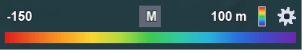 &nbsp; 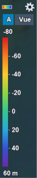

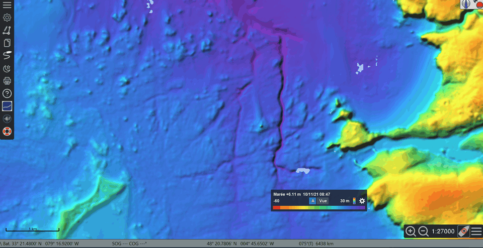

> 🧪 **Testeurs — à vérifier :** chaque clic sur le bandeau fonctionne, la
> carte ne se déplace pas quand on clique sur le bandeau ou qu'on le fait
> glisser, et le bandeau verrouillé ne se déplace pas.

## 3. Le panneau principal

Le panneau est découpé en cinq onglets :

| Onglet | Contenu |
|---|---|
| **Base** | Dossier de la base, liste des fichiers `.pdb` (case : afficher / masquer), *Tout* / *Aucun*, *Centrer*, **Gestion des données…**, *Arrêter* |
| **Marée** | Source et moment de la marée, ligne d'information, **Courbe de marée…** (§ 8) |
| **Palette** | Couleurs, seuils, mode automatique, zone dangereuse, dossier de palettes (§ 6) |
| **Isobathes et sondes** | Isobathes (intervalle, maîtresses, valeurs) et sondes chiffrées (espacement, décimales, taille du texte) (§ 7) |
| **Affichage** | Opacité, ombrage, lissage, zones interpolées, lecture au curseur, bandeau de palette (§ 7) |

La ligne *Curseur : …* (profondeur sous le curseur) reste affichée sous les
onglets, quel que soit l'onglet ouvert. Le dernier onglet ouvert est retenu.

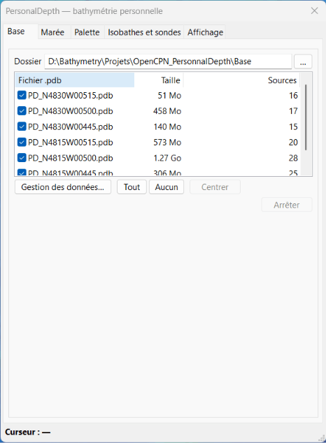

Chaque réglage s'applique immédiatement sur la carte. Le panneau peut rester
ouvert pendant l'utilisation d'OpenCPN ; le fermer conserve l'affichage.

La base est découpée en **fichiers `.pdb`**, un par cellule géographique
(0,25° × 0,25° par défaut). Décocher un fichier masque sa zone, pratique pour
comparer avec la carte officielle.

> 🧪 **Testeurs — à vérifier :** cocher / décocher un fichier `.pdb` affiche /
> masque sa zone ; *Arrêter* interrompt une opération en cours.

## 4. Importer un levé

*Base de bathymétrie* › **Gestion des données…** › **Importer…**


La fenêtre montre toujours les fichiers et les réglages courants ; les
réglages moins fréquents sont rangés dans des **sections repliables** dont
le titre résume le réglage en cours (ex. *▸ Coordonnées : Monde — WGS84 —
longitude / latitude*). Cliquer sur le titre pour ouvrir une section. Les
lignes qui ne servent pas au réglage choisi (fuseau UTM, fichiers de la
référence verticale…) sont masquées.

**Fichiers** — *Ajouter des fichiers…* ou *Ajouter un dossier…* (tous les
fichiers de bathymétrie du dossier et de ses sous-dossiers). Formats : XYZ
texte (`.xyz .txt .csv .dat`, tout séparateur, entêtes ignorés), grilles ESRI
ASCII (`.asc`), TIN LandXML (`.xml`) ; GeoTIFF / BAG si le plugin est compilé
avec GDAL.

**Réglages courants** (toujours visibles)

| Réglage | Signification |
|---|---|
| Colonnes | `X Y Z` (lon lat z / Est Nord z), `Y X Z`, ou **Format personnalisé** (voir plus bas) |
| Valeurs Z | Sens : *Automatique*, *Profondeurs positives vers le bas*, ou *Altitudes* (fond négatif, ex. Litto3D) ; unité : mètres ou pieds (la base est toujours en mètres) |
| Type de données | *Automatique*, **grille** (pas régulier, déjà traitée : jamais interpolée), *sondeur monofaisceau* (routes, profils), *nuage dense* (multifaisceau, lidar), *sondes de carte*, *sondes au plomb*, *nuage de points (autre)*. Impose le résultat de l'analyse du levé et règle la distance maximale d'interpolation (voir plus bas) |
| Interpoler entre les sondes | Nuages de points seulement : surface calculée entre les sondes à l'import, avec la méthode choisie à côté : *méthode automatique* (voisin naturel pour un levé en lignes, sinon TIN), *TIN (linéaire)*, *voisin naturel (Sibson)* ou *IDW (inverse de la distance)* (voir plus bas). *Distance max* : fixe D à la main, en mètres |
| Résolution imposée | Pas horizontal de la base pour ce levé (sondes et surface interpolée). Décoché : donné par l'analyse du levé, à conseiller en général. Une résolution plus grossière que l'espacement des sondes regroupe plusieurs sondes par case et donne un aspect en blocs |

**Sections repliables**

| Section | Contenu |
|---|---|
| Coordonnées | Système de coordonnées des X, Y (catalogue, fuseau UTM, code EPSG ou chaîne PROJ), fichier `.prj` voisin prioritaire (voir plus bas) |
| Référence verticale | Référence des Z du fichier : zéro des cartes, niveau moyen, LAT, ellipsoïde, IGN69… (voir plus bas) |
| Hauteurs d'eau observées | Corrige chaque sonde horodatée de la hauteur d'eau d'une échelle à son heure (voir plus bas) ; s'ouvre d'office si la correction est active |
| Avancé | *Décalage* (constante ajoutée aux profondeurs, dans l'unité de Z) ; *NODATA* (valeurs à ignorer, ex. `-9999 9999`, en plus du NODATA de l'entête des grilles) ; *Bornes de Z* (ne garder que les profondeurs entre Z1 et Z2, ex. −200 à 200 m écarte les remplissages) ; *Cache binaire* (`.pdpc` à côté de la source pour un réimport rapide) |

En bas : *Date du levé imposée* et *Classe*.

**Grille ou nuage de points** — chaque fichier est analysé à l'import (le
résultat s'affiche dans *Gestion des données*, ligne *Analyse*, avec la
distance D utilisée et le nombre de cases interpolées) :
- une **grille** (nœuds réguliers, donnée déjà traitée : Litto3D, NONNA,
  EMODnet, `.asc`…) est reconnue même en coordonnées projetées avec un bruit
  d'arrondi ou écrite en degrés ; elle est stockée à son pas, **sans
  interpolation** ;
- un **nuage de points** (lignes de sonde, sondes éparses, sondes de carte,
  points multifaisceaux ou lidar) n'a pas de pas défini : l'analyse mesure
  l'espacement entre voisins et, pour un **levé en lignes**, l'écart entre
  les lignes.

**Interpolation** — pour un nuage, une surface est triangulée (TIN) entre
les sondes et remplit les cases sans sonde, mais **sans jamais franchir un
vide plus large que la distance maximale D** : pour un levé en lignes, D
couvre les grands écarts entre lignes (1,25 × l'écart que dépassent seulement
5 % des intervalles entre lignes) ; sinon deux fois l'espacement des sondes
(trois fois en multifaisceaux et lidar ; pour les sondes de carte et au
plomb, au moins les grands écarts courants entre sondes, plafond 1 000 m /
500 m). Les cases interpolées sont marquées comme telles dans la base : une
case **mesurée** l'emporte toujours, quelles que soient la source et la
règle de priorité ; le panneau *Affichage* peut les masquer ou les
éclaircir (§ 7) ; les sondes affichées n'en viennent jamais et le curseur
indique *(interpolé)*. Choisir le *Type de données* réel si le résultat
automatique ne convient pas (ex. ancien levé au plomb), ou fixer la
*Distance max* : une valeur plus grande comble plus de vides, jamais moins.

La surface est calculée une seule fois, au pas des sondes (au plus D / 128),
et s'affiche **à l'identique à toutes les échelles** : pas de trou ni de
strie qui apparaît ou disparaît en zoomant.

**Méthode d'interpolation** — la zone remplie est la même pour toutes les
méthodes (les triangles dont aucun côté ne dépasse D) ; seules les valeurs
changent :
- **TIN (linéaire)** : un plan dans chaque triangle. Le plus rapide ; entre
  des lignes parallèles, les longs triangles étroits peuvent laisser des
  stries le long des lignes.
- **Voisin naturel (Sibson)** : mélange pondéré des sondes voisines (méthode
  de Sibson discrète), plus doux, sans arêtes de triangles.
- **IDW (inverse de la distance)** : moyenne des 3 sondes les plus proches
  dans chaque quart autour du point (12 au plus), à moins de D, pondérée par l'inverse du carré de la distance ; doux, mais
  forme des « cuvettes » autour des sondes isolées ou aberrantes.

La *méthode automatique* prend le voisin naturel pour un levé en lignes (pas
de traînées de triangles entre les lignes) et le TIN sinon. La méthode utilisée s'affiche avec l'analyse dans *Gestion des données*.
Pour en changer, réimporter le levé.

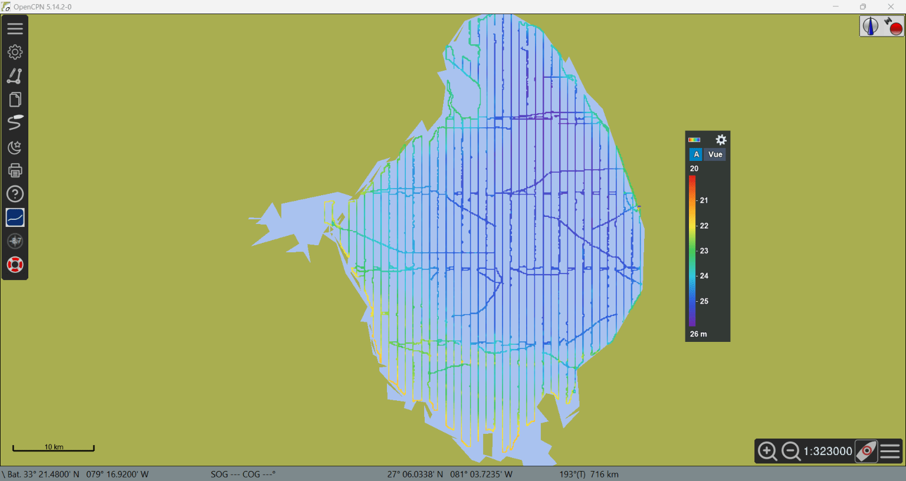 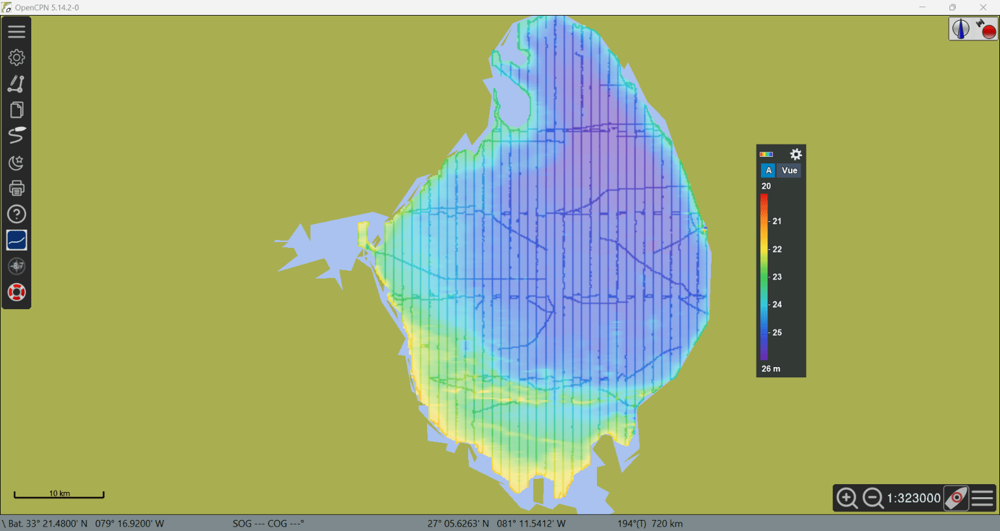

*Lac Okeechobee (NOAA) : lignes seules, puis interpolées entre les lignes.*

> 🧪 **Testeurs — à vérifier :** un levé monofaisceau en lignes donne une
> surface continue entre les lignes mais pas au travers des grands vides ;
> un fichier grille n'est pas interpolé (l'analyse indique « grille ») ;
> temps d'import et taille de la base.

**Format personnalisé** (*Colonnes* › *Format personnalisé*, bouton
**Format…**) — pour les fichiers texte qui ne sont pas de simples X Y Z :
exports GNSS / RTK, journaux de sondeur, CSV avec entête… La fenêtre s'ouvre
d'elle-même à chaque ajout de fichiers de points texte (fichiers ou dossier),
avec l'aperçu du premier fichier ajouté, et montre les premières lignes du fichier en couleur :

- *Lignes d'entête à ignorer*, *Séparateur de colonnes* (automatique,
  espaces, virgule, point-virgule, tabulation), *Séparateur décimal* (point
  ou virgule) ;
- la colonne de **X** (longitude / Est), de **Y** (latitude / Nord), de
  **Z** (profondeur), et au besoin de la **date** (ou date et heure) et de
  l'**heure**. Sous l'aperçu, la position de la première sonde est écrite en
  clair (ex. *53,7532° N, 81,3522° E*) : quand latitude et longitude sont
  toutes deux inférieures à 90° (cas fréquent, ex. export Garmin Quickdraw en
  « latitude, longitude »), l'ordre ne peut pas être deviné ; vérifier cette
  position, et un avertissement signale une latitude polaire qui trahit des
  colonnes inversées ; *Ordre des dates* pour les dates comme 03/04/2021 ; sous la
  date, le **fuseau horaire** du fichier (décalage fixe sur UTC, ex.
  UTC+08:00, sans passage à l'heure d'été ; les dates sont ramenées en UTC) ;
- des **gabarits** facultatifs sous les colonnes, comme dans les logiciels
  d'hydrographie : date / heure avec `y M d h m s z AP` (ex. `yyyy/M/d`,
  `d/M/y h:m:s.s`, `MMM d, y`, `yyyyMMddhhmmss`), coordonnées X et Y
  (chacune son gabarit) en degrés / minutes / secondes avec `D M S X` (ex.
  `D M S.S X`, `DDMM.MX` pour le NMEA). Vide = reconnaissance automatique :
  nombre décimal, ou degrés-minutes-secondes avec symboles et lettre
  d'hémisphère (`54° 00' 28.44" N`, la colonne N/S allant en Y et la colonne
  E/W en X). *Aide sur les formats…* détaille les champs avec des
  exemples ;
- sous **Z** : le sens des valeurs (profondeurs positives vers le bas,
  altitudes positives vers le haut, ou automatique) et leur unité (mètres ou
  pieds) — les mêmes réglages que dans la fenêtre d'import ;
- *Détection automatique* devine tout d'après le fichier (les noms de
  colonnes de l'entête comme `latitude`, `lon`, `depth` sont reconnus) ; les
  cases rouges sont des valeurs illisibles pour leur rôle ;
- *Enregistrer le format… / Charger un format…* gardent un format dans un
  fichier `.pdfmt` pour les levés suivants du même type.

Avec une colonne de date, la **date du levé** de la source est la première
date du fichier (sauf date du levé imposée).

**Hauteurs d'eau observées** — pour un levé dont les sondes sont mesurées
depuis la surface de l'eau (sondeur monofaisceau sur un lac, une rivière…),
chaque sonde peut être corrigée de la hauteur d'eau lue sur une échelle
limnimétrique ou un marégraphe à l'heure de la sonde. Les fichiers de
hauteurs sont des fichiers texte, une hauteur par ligne, dans l'unité de Z :

```
[TIME],[DEPTH]
2026-11-01 05:00:00,0.35
2026-11-01 06:00:00,0.41
```

(une date seule, `2026-11-01,0.35`, convient pour des valeurs journalières).
Choisir un **fichier** ou un **dossier** : tous les fichiers `.txt`, `.csv`,
`.dat` du dossier forment une seule série (une échelle, périodes
successives). La fenêtre **Format…** (la même que pour les sondes) s'ouvre
sur le premier fichier : lignes d'entête, séparateur, colonnes et gabarits
de date / heure / hauteur, **unité** des hauteurs (mètres ou pieds),
**fuseau horaire** et convention. La hauteur à l'heure de chaque sonde est interpolée entre les
deux hauteurs qui l'encadrent ; hors de la série, la valeur extrême est
gardée pendant un pas de temps (1 heure à 1 jour), au-delà la sonde est
écartée et comptée dans le résumé d'import. Par défaut **profondeur = sonde −
hauteur** (hauteur au-dessus du zéro) ; *profondeur = sonde + hauteur* est
l'autre convention. **Courbe…** affiche la série des hauteurs en UTC
(molette : zoom sur le temps, double-clic : toute la période).

Les sondes portent de préférence leur date et heure : **format
personnalisé** avec une colonne date (et heure). Sondes et hauteurs sont
comparées en UTC : régler le **fuseau horaire** de chaque format sur celui
de son fichier. **Sondes sans heure** (simple fichier `lon lat profondeur`) :
la hauteur du **jour du levé** est appliquée à tout le fichier, prise à midi
dans le fuseau des hauteurs d'eau ; le jour vient de *Date du levé* ou, à
défaut, d'une date `AAAAMMJJ` dans le nom du fichier.

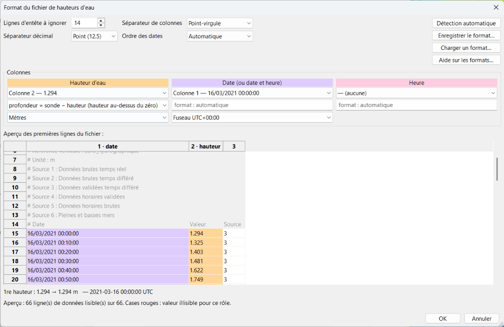

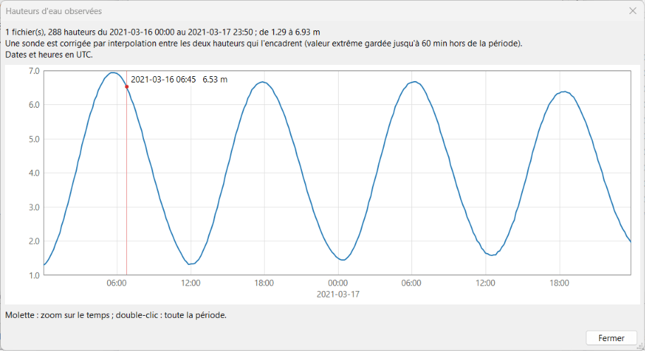

> 🧪 **Testeurs — à vérifier :** un levé avec hauteurs d'eau donne les
> profondeurs corrigées attendues ; la courbe correspond à votre échelle.

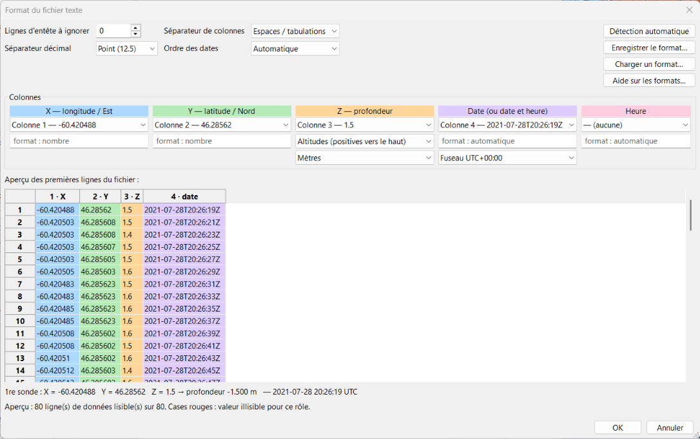

**Système de coordonnées (X, Y)** — choisir dans la liste : *Automatique*
(fichier `.prj` à côté des données, sinon longitude / latitude en degrés),
WGS84, UTM, Lambert-93, CC42–CC50, nombreux systèmes nationaux, **NAD83 State
Plane** (toutes les zones des États-Unis, en mètres, pieds US ou pieds — ex.
levés de l'USACE), ou *Autre* avec un code EPSG / une chaîne PROJ. *Utiliser
le fichier .prj voisin* est prioritaire quand le fichier en a un (les `.prj`
ESRI State Plane sont reconnus). Des coordonnées projetées (UTM, Mercator…)
ne se reconnaissent pas à leurs seules valeurs : sans fichier `.prj`, choisir
le système.

**Référence verticale des Z** — indiquer à quelle référence les profondeurs
du fichier sont rapportées. La base les range ensuite sous le **niveau moyen**
(voir [Référence verticale de la base](#référence-verticale-de-la-base)) :

| Choix | Pour | Fichiers nécessaires |
|---|---|---|
| *Zéro des cartes local* | Cartes, levés Shom, sondeur corrigé de la marée (ZH en France, *Chart Datum* ailleurs) | Aucun (BathyElli en France, FES2022 ailleurs, pour relier au niveau moyen) |
| *Niveau moyen (MSL)* | GEBCO, modèles océaniques | Aucun |
| *Plus basse mer astronomique (LAT)* | EMODnet | Atlas FES2022 (onglet *Marée*) |
| *Hauteurs ellipsoïdales* | Levé GNSS / RTK / PPK sans géoïde | BathyElli NM en France, sinon la MSS (`.pdgrid`) |
| *IGN69 / IGN78C → ZH* | Altitudes NGF (ex. Litto3D) | Dossier BathyElli + RAF20 / RAC23 |
| *Autre référence terrestre* ou *grille d'écart* | Vos propres grilles | Vos fichiers |
| *Non rattachée* | Lac, retenue, plan d'eau sans marée | Aucun : profondeurs gardées telles quelles |

Voir [external-data.md](external-data.md#français) pour obtenir ces fichiers.

**Date du levé imposée** — sinon la date est lue dans le nom du fichier
(`AAAAMMJJ`), à défaut la date du fichier. Elle sert à la règle de priorité
« plus récent ». **Classe** — étiquette libre pour regrouper les sources (ex.
`LITTO3D`, `Mes levés`) ; vide = déduite du nom du fichier.

Cliquer sur **Importer**. L'avancement s'affiche en bas de la fenêtre ;
*Arrêter* annule le fichier en cours (les fichiers terminés restent dans la
base). Les fichiers déjà présents sont détectés : importer seulement les
nouveaux, ou tout réimporter (remplacement).

> 🧪 **Testeurs — à vérifier :**
> - import d'un de vos fichiers (format, taille, système de coordonnées) ;
> - durée et mémoire pour les gros fichiers (notez la taille du fichier et le
>   nombre de sondes) ;
> - un fichier en **pieds** donne les bonnes profondeurs après import.

## 5. Gestion des données


La liste montre les sources par classe : date du levé, résolution, nombre de
sondes, rang, Z min / max, référence verticale, système de coordonnées, unité
de Z et date d'import. La case d'une source (ou d'une classe) l'inclut ou non
dans la fusion. Le cadre du bas détaille la sélection, dont la **surface
couverte** (surface des cellules de la base contenant des sondes, en km² et
NM² ; pour plusieurs sources, la somme).

| Action | Effet |
|---|---|
| **Priorité** | Règle dans les recouvrements : *Meilleure résolution, puis plus récente* (défaut), *Sonde la plus faible*, *Levé le plus récent*, *Ordre de la liste (rang manuel)*. Pas de moyenne : chaque pixel prend la valeur d'une seule source |
| ▲ ▼ | Ordre des rangs, pour la règle *rang manuel* |
| **Modifier…** (ou double-clic) | Date du levé et classe (immédiat) ; unité de Z, système de coordonnées, référence verticale (relecture des fichiers d'origine) |
| **Retirer** | Retire les sources de la base (fichiers d'origine non touchés) |
| **Nettoyer…** | Supprime les sondes hors des bornes Z1 – Z2 (ex. remplissages) |
| **Centrer** | Centre la carte sur la sélection |
| **Classer la sélection** | Donne une classe aux sources sélectionnées |
| **Redécouper…** | Change la taille des cellules des fichiers `.pdb` (cellules plus petites = fichiers plus petits) |

> 🧪 **Testeurs — à vérifier :** changer la règle de priorité modifie
> l'affichage là où deux levés se recouvrent ; *Modifier…* de la date ou de la
> classe est immédiat.

### Référence verticale de la base

Chaque source garde sa référence d'origine, mais la base range toutes les
profondeurs **sous le niveau moyen** (NM). Elle les relie aux autres
références par des surfaces calculées une fois et gardées dans le dossier de
la base (`PersonalDepth_datum.sqlite`) :

| Référence | Surface utilisée |
|---|---|
| Zéro des cartes local | France : ZH du Shom (BathyElli v2.1 NM − ZH) ; ailleurs : plus basse mer astronomique FES2022 (LAT) ; sans ces fichiers : « non défini », écart nul |
| LAT | Plus basse mer astronomique FES2022, sur 19 ans |
| Ellipsoïde WGS84 | France : BathyElli v2.1 NM ; ailleurs : surface moyenne océanique (MSS CNES_CLS 2025) |

Dans l'onglet **Base**, cadre *Référence verticale* :

- **Profondeurs** : référence des profondeurs affichées (couleurs, sondes,
  isobathes, curseur). Par défaut le *zéro des cartes local* : les valeurs
  sont celles des cartes (ENC, RNC) et une source importée au zéro des cartes
  s'affiche exactement avec ses valeurs d'origine. Avec la marée, l'affichage
  est toujours la hauteur d'eau réelle (zéro des cartes + marée).
- **MSS** : fichier de la surface moyenne océanique (`.pdgrid`), pour les
  hauteurs GNSS et l'affichage à l'ellipsoïde hors de France.
- La ligne d'information indique la référence affichée, la surface utilisée
  (ex. *ZH BathyElli v2.1*, *LAT FES2022b*, *non défini*) et les fichiers de
  référence trouvés.
- **Mettre à jour les surfaces** : après avoir ajouté ou changé BathyElli,
  l'atlas FES2022 ou la MSS, recalcule les surfaces et corrige les sources
  concernées. L'affichage au zéro des cartes d'une source importée au zéro
  des cartes ne change pas.
- **Migrer la base…** (bases créées avant la version 0.1.0-beta.10, au ZH) :
  à l'ouverture, PersonalDepth propose de ramener ces bases au niveau moyen.
  Les fichiers `.pdb` sont d'abord copiés dans `backup_before_MSL` (dans le
  dossier de la base). Sans migration, la base reste affichée telle quelle,
  mais l'import est bloqué. Une base migrée ne doit plus être ouverte avec
  une version antérieure du plugin.

Le **Nettoyage** (bornes Z1 – Z2) compare les profondeurs au zéro des cartes
local, comme les cartes.

> 🧪 **Testeurs — à vérifier :** après migration, les profondeurs au zéro des
> cartes sont identiques à celles d'avant ; *Niveau moyen* les augmente de la
> hauteur du NM au-dessus du ZH (environ 4 m à Brest) ; un fichier GEBCO
> importé au *niveau moyen* s'affiche au zéro des cartes.

### Trait de côte

Entre deux lignes de sondes, la surface interpolée peut enjamber une île ou
une pointe. Le cadre *Trait de côte* de l'onglet **Base** l'évite :

- **Dossier** : dossier des fonds de carte téléchargés par le gestionnaire de
  cartes d'OpenCPN, **OSMSHP** (polygones de terre d'OpenStreetMap,
  `basemap_*.shp`, conseillé : précis à quelques mètres) ou **GSHHG**
  (`poly-*-1.dat`, plus grossier : trait parfois décalé d'une centaine de
  mètres, petites îles absentes). Le dossier qui contient les deux convient :
  OSMSHP est préféré, dans sa meilleure qualité présente (`full`, puis `high`…).
- **Pas de surface interpolée sur la terre** : à l'import, les pixels
  interpolés situés sur la terre sont retirés. Les sondes mesurées sont
  toujours gardées (levés d'estran, Litto3D).
- **Appliquer aux sources** : retire l'interpolation sur la terre des sources
  déjà importées. Pour la retrouver, réimporter la source.

Voir [external-data.md](external-data.md#français) pour télécharger ces fonds.

> 🧪 **Testeurs — à vérifier :** un levé en lignes autour d'une île ne la
> couvre plus ; les sondes mesurées sur l'estran restent affichées.

## 6. Palette et seuils de profondeur


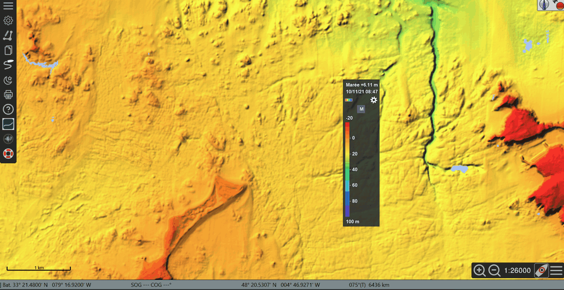

- **Préréglages** : *TimeZero PBG (bleus)*, *Carte marine (paliers)*,
  *ENC OpenCPN (S-52)* (les couleurs de profondeur des cartes vectorielles
  d'OpenCPN, avec les isobathes peu profonde / de sécurité / profonde réglées
  dans *Options › Cartes › Cartes vectorielles*), *Arc-en-ciel*, *Sécurité
  tirant d'eau*, *Niveaux de gris*. Toute modification passe en
  *(personnalisée)*.
- **Dégradé continu** ou **Paliers**.
- **Tableau** : une ligne par seuil (profondeur, couleur). Modifier une
  profondeur directement, double-cliquer sur une couleur pour la changer ;
  *+ seuil* / *− seuil*.
- **Importer .cpt… / Exporter .cpt…** : palettes GMT.
- **Dossier de palettes** : toutes les palettes sont des fichiers `.cpt`
  d'un même dossier (*Dossier de palettes…* pour le choisir), palettes
  d'origine comprises : elles y sont écrites la première fois, puis se
  modifient, se renomment ou se suppriment comme les autres. Seule *ENC
  OpenCPN (S-52)* reste à part, car elle suit les isobathes réglées dans
  OpenCPN. *Enregistrer la palette…* range la palette affichée (seuils,
  couleurs, paliers ou dégradé, zone dangereuse) dans le dossier ; les
  palettes GMT `.cpt` qui y sont copiées sont aussi proposées. *Restaurer les
  palettes d'origine* réécrit les palettes livrées (les fichiers du même nom
  sont remplacés). La liste est la même dans le panneau et dans le menu de la
  rampe du bandeau.
- **Automatique** : N seuils répartis entre la profondeur minimale et maximale
  de *toutes les données* ou de la *zone affichée* (recalculé quand la carte
  bouge), *valeurs rondes*, *min imposé* / *max imposé* facultatifs (ex. min
  imposé 0 m : la palette couvre seulement les fonds). Modifier un seuil à la
  main désactive le mode automatique.
- **Zone dangereuse si prof. < X** : surcouche des zones moins profondes que
  votre tirant d'eau plus une marge ; l'isobathe de sécurité rouge la suit.

Les profondeurs sont positives vers le bas ; les valeurs négatives sont
au-dessus de la référence affichée (estran, terre).

> 🧪 **Testeurs — à vérifier :** chaque changement de palette est immédiat
> sur la carte (sans rechargement) ; la zone dangereuse correspond à la
> profondeur choisie.

## 7. Isobathes, sondes et affichage


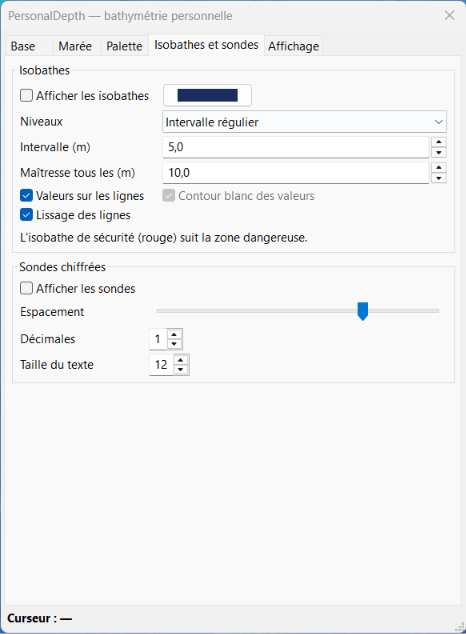

**Onglet Isobathes et sondes**

**Isobathes** — *Afficher les isobathes* ; niveaux à *Intervalle régulier* ou
sur les *Seuils de la palette* ; *Maîtresse tous les* N unités (trait épais) ;
*Valeurs sur les lignes* (chiffres pleins, à la couleur des lignes) ;
*Lissage des lignes* (purement graphique). Aucune
ligne n'est tracée dans les trous du levé.

**Sondes chiffrées** — *Afficher les sondes* : sondes exactes (la plus
faible par case d'écran), jamais prises dans les zones interpolées ;
*Espacement* (écart minimal entre deux sondes à l'écran) ; *Décimales* ;
*Taille du texte* (sondes et valeurs des isobathes).

**Onglet Affichage**

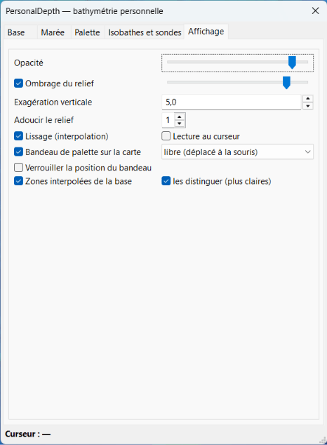

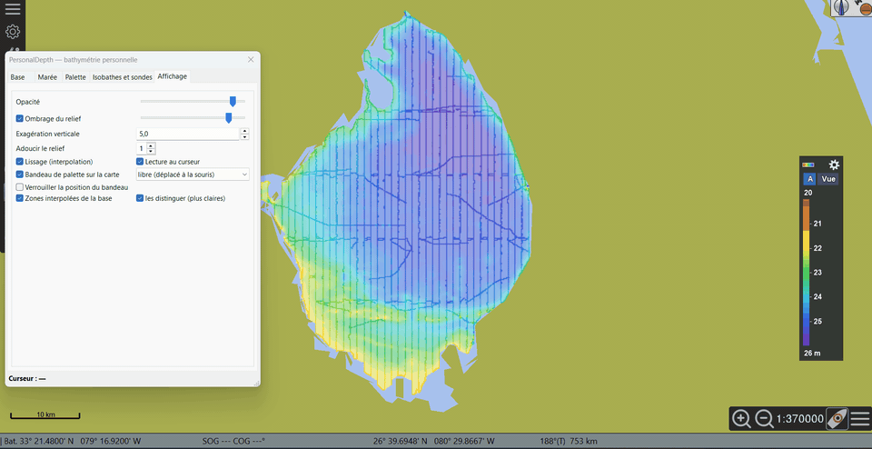

| Réglage | Effet |
|---|---|
| Opacité | Transparence de la surface colorée sur la carte |
| Ombrage du relief | Ombrage et son intensité |
| Exagération verticale | Accentue le relief de l'ombrage |
| Adoucir le relief | Lisse l'ombrage seul (couleurs, isobathes et sondes gardent les vraies profondeurs) |
| Lissage (interpolation) | Couleurs fondues entre les mailles |
| Zones interpolées de la base | Affiche la surface interpolée à l'import entre les sondes ; *les distinguer (plus claires)* éclaircit ses couleurs |
| Lecture au curseur | Profondeur et source à côté du curseur |
| Bandeau de palette sur la carte | Affiche le bandeau et choisit sa position |

> 🧪 **Testeurs — à vérifier :** isobathes et sondes lisibles, sans trop de
> chevauchements ; la lecture au curseur donne la même valeur que la sonde
> sous le curseur.

## 8. Marée


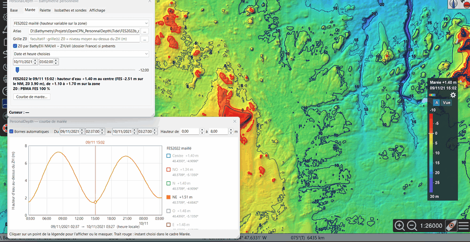

Sans marée, les profondeurs sont affichées dans la référence choisie (onglet
*Base*, par défaut le zéro des cartes local). Le cadre *Marée* ajoute la
hauteur d'eau d'un moment donné au zéro des cartes, pixel par pixel :

- **Source** : *Stations de marée OpenCPN* (hauteur unique de la station la
  plus proche ; les données de marée d'OpenCPN doivent être activées) ou
  *FES2022 maillé* (hauteur variable sur la zone ; nécessite l'atlas converti,
  voir [external-data.md](external-data.md#français)).
- **Moment** : *Aucune — profondeurs au zéro hydrographique*, *Hauteur d'eau
  actuelle (heure du PC)*, ou *Date et heure choisies* avec le curseur ±12 h
  par pas de 15 min.
- La ligne d'information donne la hauteur utilisée, la station ou l'étendue
  FES2022 sur la zone.

**Courbe de marée…** ouvre une fenêtre indépendante : hauteur d'eau en fonction
du temps pour chaque point de marée utilisé (la station OpenCPN, ou jusqu'à
9 points FES2022 — NO, N, NE, O, Centre, E, SO, S, SE — répartis sur vos
données).


- Cliquer sur un point de la légende pour afficher ou masquer sa courbe.
- *Bornes automatiques* : un cycle de marée (24 h 50) autour du moment
  choisi ; modifier une borne (dates, hauteurs) passe en bornes manuelles.
- Le trait rouge marque le moment choisi (en direct en mode *Hauteur d'eau
  actuelle*).

> 🧪 **Testeurs — à vérifier :** la hauteur de la station correspond à la
> fenêtre de marée d'OpenCPN ; le trait rouge de la courbe suit le moment
> choisi dans le panneau.

## 9. Unités et langue

- Les **unités** suivent OpenCPN : *Options › Affichage › Unités* (mètres ou
  pieds ; les brasses sont affichées en pieds). Sondes, isobathes, légende,
  seuils, zone dangereuse et hauteurs de marée changent ensemble.
- La **langue** suit OpenCPN : *Options › Utilisateur › Options générales ›
  Langue*. Français → français ; russe → russe ; toute autre langue →
  anglais, sauf si un fichier de traduction existe pour elle (ci-dessous).
  Les noms de classe et libellés enregistrés dans la base restent dans la
  langue où ils ont été créés.
- **Fichiers de traduction** — les traductions autres que l'anglais sont des
  fichiers texte `PersonalDepth_<code>.po` (format gettext, modifiable dans un
  éditeur de texte ou dans Poedit) : `msgid` = texte anglais, `msgstr` =
  traduction, et en commentaire le texte français d'origine. Le plugin livre
  `PersonalDepth_ru.po` dans `data/lang` de son dossier. Pour corriger une
  traduction ou en ajouter une (ex. `PersonalDepth_de.po` pour l'allemand),
  placer le fichier dans le sous-dossier `lang` du dossier utilisateur du
  plugin (celui qui contient le dossier `palettes`, sous Windows
  `%LOCALAPPDATA%\opencpn\plugins\PersonalDepth_pi\lang`) : il est lu après le
  fichier livré, ses entrées l'emportent, et les mises à jour du plugin ne le
  touchent pas. Il suffit d'y mettre les entrées modifiées. Relancer OpenCPN
  pour l'appliquer. Une traduction dont les `%d`, `%s`, `%.2f`… diffèrent de
  l'anglais est ignorée (signalée dans le journal d'OpenCPN).

> 🧪 **Testeurs — à vérifier :** passer OpenCPN de mètres en pieds met à jour
> tout l'affichage ; textes anglais ou russes erronés ou restés en français
> (merci de les citer).

## 10. Signaler un problème

Utiliser le [formulaire de signalement](https://github.com/margouilla/PersonalDepth_pi/issues/new?template=bug_report.yml)
(compte GitHub gratuit nécessaire) ou le
[fil Cruisers Forum](https://www.cruisersforum.com/forums/f134/plugin-dev-dynamic-bathymetry-and-topography-grid-overlay-302721.html).
Indiquer :

1. votre **système** et la **version d'OpenCPN** (fenêtre *À propos*, bouton ?
   de la barre d'outils), et le **nom du fichier** installé ;
2. ce que vous avez fait, ce que vous attendiez, ce qui s'est passé ;
3. une **capture d'écran** pour un problème d'affichage ;
4. la fin du **journal d'OpenCPN** (lignes contenant `PersonalDepth` et
   dernières lignes avant un plantage) :

   | Système | Journal |
   |---|---|
   | Windows | `C:\ProgramData\opencpn\opencpn.log` |
   | Linux, Raspberry Pi | `~/.opencpn/opencpn.log` |
   | macOS | `~/Library/Preferences/opencpn/opencpn.log` |

## 11. Questions fréquentes et limites connues

**Toute la surface est d'une seule couleur.** Les données contiennent
probablement des valeurs de remplissage (ex. −9999 ou 999). Utiliser *Gestion
des données › Nettoyer…* avec des bornes comme −200 / 200 m, ou réimporter
avec *NODATA* et *Bornes de Z*.

**Rien ne s'affiche.** Vérifier qu'OpenGL est activé, que les fichiers `.pdb`
sont cochés, et que la carte est sur la zone des données (*Centrer*).

**L'import est long.** Les grosses grilles (centaines de millions de sondes)
prennent plusieurs minutes ; l'import peut être arrêté puis repris
(*seulement les nouveaux fichiers*). Sur Raspberry Pi, mieux vaut importer sur
un PC puis copier les fichiers `.pdb`.

**Limites connues**
- Paquets Linux, Raspberry Pi et macOS nouveaux, en cours de test.
- OpenCPN en Flatpak (Flathub) pas encore pris en charge.
- Pas compatible Android (OpenGL ES).
- Projection de carte supposée Mercator ; antiméridien non géré.
- Datums anciens (NTF, ED50, OSGB36…) : paramètres de Helmert moyens (~1–2 m).
- L'interpolation est faite à l'import : réimporter un levé pour appliquer
  un autre type de levé, une autre nature ou une autre distance max. Les
  levés en lignes importés avant la beta.9 sont à réimporter (surface
  interpolée calculée autrement).
- Les fichiers texte de plus de 200 Mo sont importés par blocs (mémoire
  limitée) ; un levé très dense donne une grosse base : une *Résolution
  imposée* (ex. 0,5 m) la réduit fortement.
