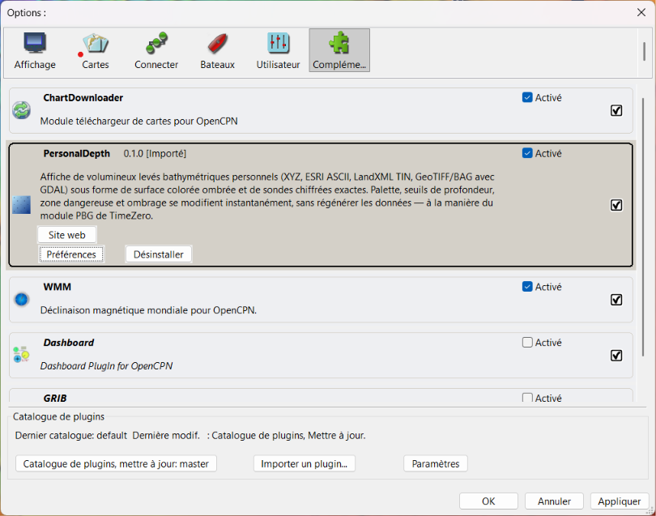
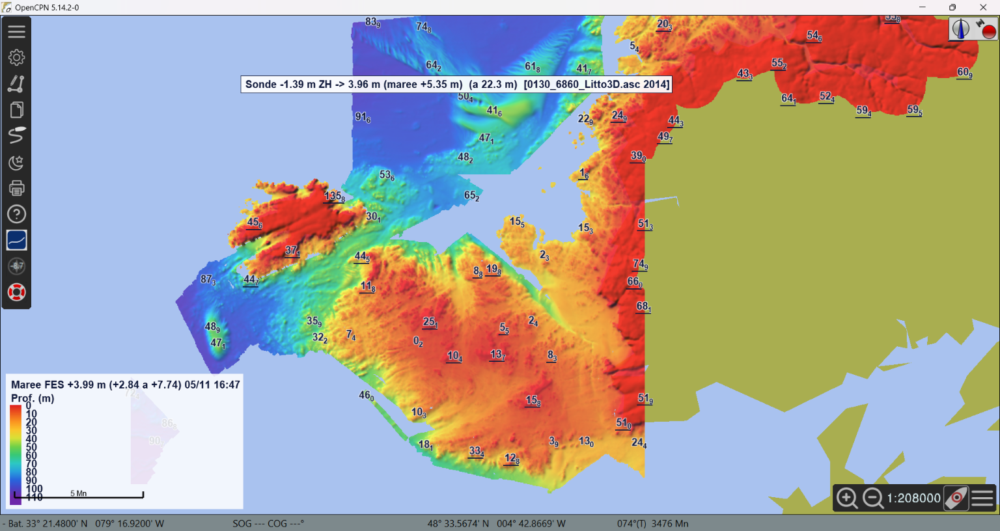
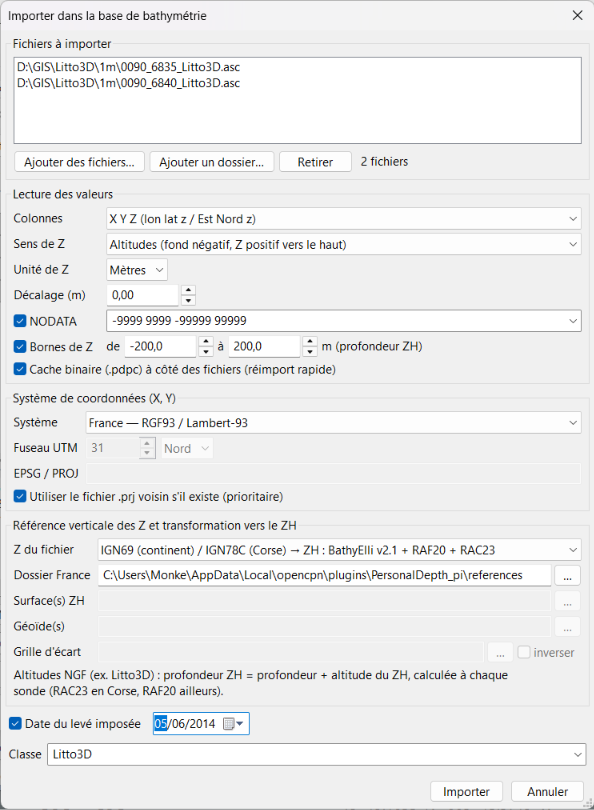
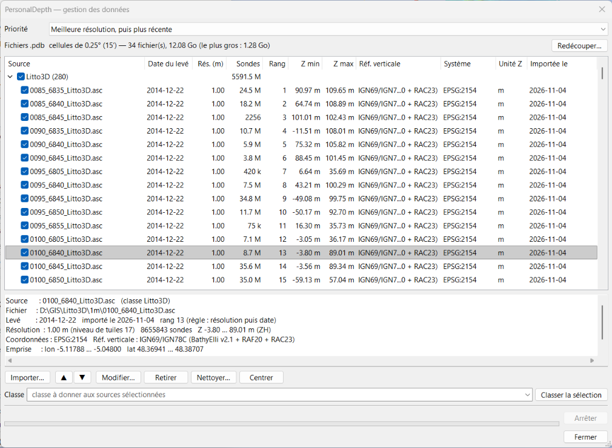
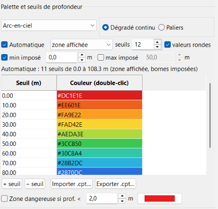
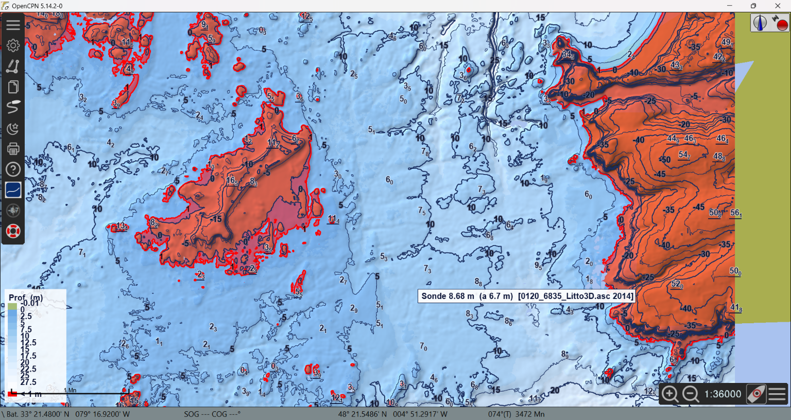
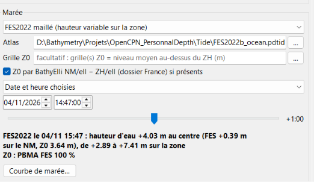
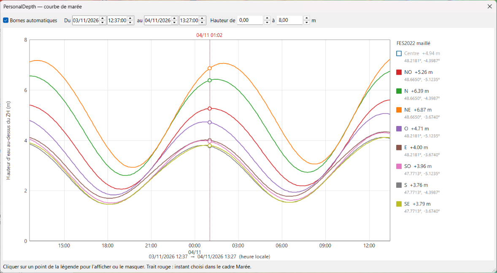

# PersonalDepth — Mode d'emploi

[🇬🇧 English version](user-guide.md) · [README](../README.md) · [Nouveautés](../CHANGELOG.md#français)

> ⚠️ Logiciel en test — **ne pas utiliser pour la navigation**. Utilisez
> toujours les cartes officielles.

PersonalDepth affiche dans OpenCPN vos propres levés bathymétriques haute
résolution (nuages de points XYZ, grilles, TIN) sous forme de surface colorée
et ombrée, avec les sondes exactes. Les levés sont importés une seule fois dans
une base locale ; la palette, les seuils de profondeur, la zone dangereuse et
l'ombrage se règlent ensuite en direct, sans rien régénérer.

> 🧪 **Testeurs** — les encadrés comme celui-ci indiquent quoi vérifier dans
> chaque partie. Tout fonctionne ? Envoyez un court
> [retour de test](https://github.com/margouilla/PersonalDepth_pi/issues/new?template=test_report.yml).
> Un problème ? [Signalez-le](https://github.com/margouilla/PersonalDepth_pi/issues/new?template=bug_report.yml)
> — voir [§10](#10-signaler-un-problème) pour les informations utiles.

**Sommaire**
1. [Installation](#1-installation)
2. [Premier essai en 5 minutes (données d'exemple)](#2-premier-essai-en-5-minutes-données-dexemple)
3. [Le panneau principal](#3-le-panneau-principal)
4. [Importer un levé](#4-importer-un-levé)
5. [Gestion des données](#5-gestion-des-données)
6. [Palette et seuils de profondeur](#6-palette-et-seuils-de-profondeur)
7. [Isobathes et affichage](#7-isobathes-et-affichage)
8. [Marée](#8-marée)
9. [Unités et langue](#9-unités-et-langue)
10. [Signaler un problème](#10-signaler-un-problème)
11. [Questions fréquentes et limites connues](#11-questions-fréquentes-et-limites-connues)

---

## 1. Installation

Il faut **OpenCPN 5.14 ou plus récent**, avec OpenGL activé (*Options ›
Affichage › Avancé › Utiliser l'accélération graphique (OpenGL)*).

1. Télécharger le fichier de votre système dans
   [Releases](https://github.com/margouilla/PersonalDepth_pi/releases)
   (prendre la **pre-release** la plus récente) :

   | Système | Fichier `PersonalDepth-<version>_…` |
   |---|---|
   | Windows (OpenCPN 32 bits) | `msvc-wx32-10.tar.gz` |
   | macOS 11 ou plus récent, Intel et Apple Silicon | `darwin-wx32-10-universal.tar.gz` |
   | Debian 12, Ubuntu 24.04 (PPA OpenCPN) — PC 64 bits | `debian-x86_64-12-x86_64.tar.gz` |
   | Debian 13 — PC 64 bits | `debian-x86_64-13-x86_64.tar.gz` |
   | Raspberry Pi OS 64 bits bookworm | `debian-arm64-12-arm64.tar.gz` |
   | Raspberry Pi OS 64 bits trixie | `debian-arm64-13-arm64.tar.gz` |
   | Raspberry Pi OS 32 bits bookworm | `debian-armhf-12-armhf.tar.gz` |

   Ne pas prendre les archives *Source code* : ce n'est pas le plugin.
2. Dans OpenCPN : *Options › Plugins › Importer un plugin…*, choisir le fichier.
3. Cocher **Activer** en face de PersonalDepth, puis *OK*.
4. Cliquer sur l'icône PersonalDepth de la barre d'outils : le panneau
   principal s'ouvre.

> 🧪 **Testeurs — à vérifier :**
> - l'import est accepté (pas de message « plugin incompatible ») ;
> - l'icône apparaît et ouvre le panneau sans plantage ;
> - notez votre système, la version d'OpenCPN et le nom du fichier pour le
>   retour de test.

## 2. Premier essai en 5 minutes (données d'exemple)

Des fichiers de base prêts à l'emploi pour la mer d'Iroise (Litto3D®
Finistère 2014, résolution 1 m, profondeurs au zéro hydrographique)
permettent de voir le rendu sans rien importer.

1. Télécharger les fichiers `.pdb` de la release
   [data-litto3d-finistere-samples](https://github.com/margouilla/PersonalDepth_pi/releases/tag/data-litto3d-finistere-samples)
   et les placer **dans un même dossier** (ex. `Documents/PersonalDepth/base`).
2. Panneau PersonalDepth, cadre *Base de bathymétrie* : cliquer sur **…** et
   choisir ce dossier. Les fichiers `.pdb` apparaissent dans la liste.
3. Sélectionner les fichiers et cliquer sur **Centrer** : la carte se place
   sur la mer d'Iroise.
4. Zoomer : la surface colorée apparaît, puis les sondes chiffrées aux grandes
   échelles.

> 🧪 **Testeurs — à vérifier :**
> - la surface colorée et ombrée s'affiche (pas une couleur uniforme) ;
> - déplacement et zoom restent fluides ; les sondes apparaissent aux grandes
>   échelles ;
> - le curseur sur les données affiche la profondeur dans la légende
>   (*Curseur : …*).

## 3. Le panneau principal

Le panneau comprend cinq cadres, de haut en bas :

| Cadre | Rôle |
|---|---|
| **Base de bathymétrie** | Dossier de la base, liste des fichiers `.pdb` (case : afficher / masquer), *Tout* / *Aucun*, *Centrer*, **Gestion des données…**, *Arrêter* |
| **Marée** | Source et moment de la marée, ligne d'information, **Courbe de marée…** |
| **Palette et seuils de profondeur** | Couleurs, seuils, mode automatique, zone dangereuse |
| **Isobathes** | Intervalle, isobathes maîtresses, valeurs |
| **Affichage** | Opacité, ombrage, sondes, lissage, légende |

Chaque réglage s'applique immédiatement sur la carte. Le panneau peut rester
ouvert pendant l'utilisation d'OpenCPN ; le fermer conserve l'affichage.

La base est découpée en **fichiers `.pdb`**, un par cellule géographique
(0,25° × 0,25° par défaut). Décocher un fichier masque sa zone, pratique pour
comparer avec la carte officielle.

> 🧪 **Testeurs — à vérifier :** cocher / décocher un fichier `.pdb` affiche /
> masque sa zone ; *Arrêter* interrompt une opération en cours.

## 4. Importer un levé

*Base de bathymétrie* › **Gestion des données…** › **Importer…**

**Fichiers** — *Ajouter des fichiers…* ou *Ajouter un dossier…* (tous les
fichiers de bathymétrie du dossier et de ses sous-dossiers). Formats : XYZ
texte (`.xyz .txt .csv .dat`, tout séparateur, entêtes ignorés), grilles ESRI
ASCII (`.asc`), TIN LandXML (`.xml`) ; GeoTIFF / BAG si le plugin est compilé
avec GDAL.

**Lecture des valeurs**

| Réglage | Signification |
|---|---|
| Colonnes | `X Y Z` (lon lat z / Est Nord z) ou `Y X Z` |
| Sens de Z | *Automatique*, *Profondeurs positives vers le bas*, ou *Altitudes* (fond négatif, ex. Litto3D) |
| Unité de Z | Mètres ou Pieds. La base est toujours en mètres |
| Décalage | Constante ajoutée aux profondeurs, dans l'unité de Z |
| NODATA | Valeurs à ignorer (ex. `-9999 9999`), en plus du NODATA de l'entête des grilles |
| Bornes de Z | Ne garder que les profondeurs entre Z1 et Z2 (ex. −200 à 200 m écarte les remplissages) |
| Cache binaire | Fichier `.pdpc` à côté de la source pour un réimport rapide |

**Système de coordonnées (X, Y)** — choisir dans la liste (WGS84, UTM,
Lambert-93, CC42–CC50, nombreux systèmes nationaux), ou *Autre* avec un code
EPSG / une chaîne PROJ. *Utiliser le fichier .prj voisin* est prioritaire
quand le fichier en a un.

**Référence verticale des Z et transformation vers le ZH** — les profondeurs
doivent être rapportées au **zéro hydrographique** (ZH, la référence des
cartes marines) :
- *Zéro hydrographique — aucune transformation* : données déjà au ZH (cartes,
  levés Shom) ;
- *IGN69 / IGN78C → ZH* : altitudes NGF (ex. Litto3D), nécessite le dossier
  BathyElli + RAF20 / RAC23 ;
- *Hauteurs ellipsoïdales → ZH* : levé GNSS sans géoïde, nécessite BathyElli ;
- *Autre référence terrestre* ou *grille d'écart* : vos propres grilles.
Voir [external-data.md](external-data.md#français) pour obtenir ces fichiers.

**Date du levé imposée** — sinon la date est lue dans le nom du fichier
(`AAAAMMJJ`), à défaut la date du fichier. Elle sert à la règle de priorité
« plus récent ». **Classe** — étiquette libre pour regrouper les sources (ex.
`LITTO3D`, `Mes levés`) ; vide = déduite du nom du fichier.

Cliquer sur **Importer**. L'avancement s'affiche en bas de la fenêtre ;
*Arrêter* annule le fichier en cours (les fichiers terminés restent dans la
base). Les fichiers déjà présents sont détectés : importer seulement les
nouveaux, ou tout réimporter (remplacement).

> 🧪 **Testeurs — à vérifier :**
> - import d'un de vos fichiers (format, taille, système de coordonnées) ;
> - durée et mémoire pour les gros fichiers (notez la taille du fichier et le
>   nombre de sondes) ;
> - un fichier en **pieds** donne les bonnes profondeurs après import.

## 5. Gestion des données

La liste montre les sources par classe : date du levé, résolution, nombre de
sondes, rang, Z min / max, référence verticale, système de coordonnées, unité
de Z et date d'import. La case d'une source (ou d'une classe) l'inclut ou non
dans la fusion. Le cadre du bas détaille la sélection.

| Action | Effet |
|---|---|
| **Priorité** | Règle dans les recouvrements : *Meilleure résolution, puis plus récente* (défaut), *Sonde la plus faible*, *Levé le plus récent*, *Ordre de la liste (rang manuel)*. Pas de moyenne : chaque pixel prend la valeur d'une seule source |
| ▲ ▼ | Ordre des rangs, pour la règle *rang manuel* |
| **Modifier…** (ou double-clic) | Date du levé et classe (immédiat) ; unité de Z, système de coordonnées, référence verticale (relecture des fichiers d'origine) |
| **Retirer** | Retire les sources de la base (fichiers d'origine non touchés) |
| **Nettoyer…** | Supprime les sondes hors des bornes Z1 – Z2 (ex. remplissages) |
| **Centrer** | Centre la carte sur la sélection |
| **Classer la sélection** | Donne une classe aux sources sélectionnées |
| **Redécouper…** | Change la taille des cellules des fichiers `.pdb` (cellules plus petites = fichiers plus petits) |

> 🧪 **Testeurs — à vérifier :** changer la règle de priorité modifie
> l'affichage là où deux levés se recouvrent ; *Modifier…* de la date ou de la
> classe est immédiat.

## 6. Palette et seuils de profondeur

- **Préréglages** : *TimeZero PBG (bleus)*, *Carte marine (paliers)*,
  *Arc-en-ciel*, *Sécurité tirant d'eau*, *Niveaux de gris*. Toute
  modification passe en *(personnalisée)*.
- **Dégradé continu** ou **Paliers**.
- **Tableau** : une ligne par seuil (profondeur, couleur). Modifier une
  profondeur directement, double-cliquer sur une couleur pour la changer ;
  *+ seuil* / *− seuil*.
- **Importer .cpt… / Exporter .cpt…** : palettes GMT.
- **Automatique** : N seuils répartis entre la profondeur minimale et maximale
  de *toutes les données* ou de la *zone affichée* (recalculé quand la carte
  bouge), *valeurs rondes*, *min imposé* / *max imposé* facultatifs (ex. min
  imposé 0 m : la palette couvre seulement les fonds). Modifier un seuil à la
  main désactive le mode automatique.
- **Zone dangereuse si prof. < X** : surcouche des zones moins profondes que
  votre tirant d'eau plus une marge ; l'isobathe de sécurité rouge la suit.

Les profondeurs sont positives vers le bas ; les valeurs négatives sont
au-dessus du ZH (estran, terre).

> 🧪 **Testeurs — à vérifier :** chaque changement de palette est immédiat
> sur la carte (sans rechargement) ; la zone dangereuse correspond à la
> profondeur choisie.

## 7. Isobathes et affichage

**Isobathes** — *Afficher les isobathes* ; niveaux à *Intervalle régulier* ou
sur les *Seuils de la palette* ; *Maîtresse tous les* N unités (trait épais) ;
*Valeurs sur les lignes* ; *Lissage des lignes* (purement graphique). Aucune
ligne n'est tracée dans les trous du levé.

**Affichage**

| Réglage | Effet |
|---|---|
| Opacité | Transparence de la surface colorée sur la carte |
| Ombrage du relief | Ombrage et son intensité |
| Exagération verticale | Accentue le relief de l'ombrage |
| Adoucir le relief | Lisse l'ombrage seul (couleurs, isobathes et sondes gardent les vraies profondeurs) |
| Sondes chiffrées | Sondes exactes (la plus faible par case d'écran), espacement, décimales, taille du texte |
| Lissage (interpolation) | Couleurs fondues entre les mailles |
| Légende + lecture au curseur | Légende dans le coin, profondeur et source sous le curseur |

> 🧪 **Testeurs — à vérifier :** isobathes et sondes lisibles, sans trop de
> chevauchements ; la lecture au curseur donne la même valeur que la sonde
> sous le curseur.

## 8. Marée

Par défaut, les profondeurs affichées sont au ZH. Le cadre *Marée* ajoute la
hauteur d'eau d'un moment donné, pixel par pixel :

- **Source** : *Stations de marée OpenCPN* (hauteur unique de la station la
  plus proche ; les données de marée d'OpenCPN doivent être activées) ou
  *FES2022 maillé* (hauteur variable sur la zone ; nécessite l'atlas converti,
  voir [external-data.md](external-data.md#français)).
- **Moment** : *Aucune — profondeurs au zéro hydrographique*, *Hauteur d'eau
  actuelle (heure du PC)*, ou *Date et heure choisies* avec le curseur ±12 h
  par pas de 15 min.
- La ligne d'information donne la hauteur utilisée, la station ou l'étendue
  FES2022 sur la zone.

**Courbe de marée…** ouvre une fenêtre indépendante : hauteur d'eau en fonction
du temps pour chaque point de marée utilisé (la station OpenCPN, ou jusqu'à
9 points FES2022 — NO, N, NE, O, Centre, E, SO, S, SE — répartis sur vos
données).

- Cliquer sur un point de la légende pour afficher ou masquer sa courbe.
- *Bornes automatiques* : un cycle de marée (24 h 50) autour du moment
  choisi ; modifier une borne (dates, hauteurs) passe en bornes manuelles.
- Le trait rouge marque le moment choisi (en direct en mode *Hauteur d'eau
  actuelle*).

> 🧪 **Testeurs — à vérifier :** la hauteur de la station correspond à la
> fenêtre de marée d'OpenCPN ; le trait rouge de la courbe suit le moment
> choisi dans le panneau.

## 9. Unités et langue

- Les **unités** suivent OpenCPN : *Options › Affichage › Unités* (mètres ou
  pieds ; les brasses sont affichées en pieds). Sondes, isobathes, légende,
  seuils, zone dangereuse et hauteurs de marée changent ensemble.
- La **langue** suit OpenCPN : *Options › Utilisateur › Options générales ›
  Langue*. Français → français ; toute autre langue → anglais. Les noms de
  classe et libellés enregistrés dans la base restent dans la langue où ils
  ont été créés.

> 🧪 **Testeurs — à vérifier :** passer OpenCPN de mètres en pieds met à jour
> tout l'affichage ; textes anglais erronés ou restés en français (merci de
> les citer).

## 10. Signaler un problème

Utiliser le [formulaire de signalement](https://github.com/margouilla/PersonalDepth_pi/issues/new?template=bug_report.yml)
(compte GitHub gratuit nécessaire) ou le
[fil Cruisers Forum](https://www.cruisersforum.com/forums/f134/plugin-dev-dynamic-bathymetry-and-topography-grid-overlay-302721.html).
Indiquer :

1. votre **système** et la **version d'OpenCPN** (fenêtre *À propos*, bouton ?
   de la barre d'outils), et le **nom du fichier** installé ;
2. ce que vous avez fait, ce que vous attendiez, ce qui s'est passé ;
3. une **capture d'écran** pour un problème d'affichage ;
4. la fin du **journal d'OpenCPN** (lignes contenant `PersonalDepth` et
   dernières lignes avant un plantage) :

   | Système | Journal |
   |---|---|
   | Windows | `C:\ProgramData\opencpn\opencpn.log` |
   | Linux, Raspberry Pi | `~/.opencpn/opencpn.log` |
   | macOS | `~/Library/Preferences/opencpn/opencpn.log` |

## 11. Questions fréquentes et limites connues

**Toute la surface est d'une seule couleur.** Les données contiennent
probablement des valeurs de remplissage (ex. −9999 ou 999). Utiliser *Gestion
des données › Nettoyer…* avec des bornes comme −200 / 200 m, ou réimporter
avec *NODATA* et *Bornes de Z*.

**Rien ne s'affiche.** Vérifier qu'OpenGL est activé, que les fichiers `.pdb`
sont cochés, et que la carte est sur la zone des données (*Centrer*).

**L'import est long.** Les grosses grilles (centaines de millions de sondes)
prennent plusieurs minutes ; l'import peut être arrêté puis repris
(*seulement les nouveaux fichiers*). Sur Raspberry Pi, mieux vaut importer sur
un PC puis copier les fichiers `.pdb`.

**Limites connues**
- Paquets Linux, Raspberry Pi et macOS nouveaux, en cours de test.
- OpenCPN en Flatpak (Flathub) pas encore pris en charge.
- Pas compatible Android (OpenGL ES).
- Projection de carte supposée Mercator ; antiméridien non géré.
- Datums anciens (NTF, ED50, OSGB36…) : paramètres de Helmert moyens (~1–2 m).
