# PersonalDepth — User guide

[🇫🇷 Version française](guide-utilisateur.md) · [README](../README.md) · [What's new](../CHANGELOG.md)

> ⚠️ Beta software — **not for navigation**. Always use official charts.

PersonalDepth displays your own high-resolution bathymetric surveys (XYZ point
clouds, grids, TIN) in OpenCPN, as a coloured and shaded surface with the
exact soundings. The surveys are imported once into a local database; the
palette, the depth thresholds, the safety depth and the shading then change
instantly, without regenerating anything.

> 🧪 **Testers** — boxes like this one list what to check in each section.
> Everything works? Send a short [test report](https://github.com/margouilla/PersonalDepth_pi/issues/new?template=test_report.yml).
> Something wrong? [Report a problem](https://github.com/margouilla/PersonalDepth_pi/issues/new?template=bug_report.yml)
> — see [§10](#10-reporting-a-problem) for what to include.

**Contents**
1. [Installation](#1-installation)
2. [First try in 5 minutes (sample data)](#2-first-try-in-5-minutes-sample-data)
3. [The main panel](#3-the-main-panel)
4. [Importing a survey](#4-importing-a-survey)
5. [Data management](#5-data-management)
6. [Palette and depth thresholds](#6-palette-and-depth-thresholds)
7. [Depth contours and display](#7-depth-contours-and-display)
8. [Tide](#8-tide)
9. [Units and language](#9-units-and-language)
10. [Reporting a problem](#10-reporting-a-problem)
11. [FAQ and known limitations](#11-faq-and-known-limitations)

---

## 1. Installation

You need **OpenCPN 5.14 or newer**, with OpenGL enabled (*Options › Display ›
Advanced › Use accelerated graphics (OpenGL)*).

1. Download the file for your system from
   [Releases](https://github.com/margouilla/PersonalDepth_pi/releases)
   (take the most recent **pre-release**):

   | System | File `PersonalDepth-<version>_…` |
   |---|---|
   | Windows (OpenCPN 32-bit) | `msvc-wx32-10.tar.gz` |
   | macOS 11 or newer, Intel and Apple Silicon | `darwin-wx32-10-universal.tar.gz` |
   | Debian 12, Ubuntu 24.04 (OpenCPN PPA) — 64-bit PC | `debian-x86_64-12-x86_64.tar.gz` |
   | Debian 13 — 64-bit PC | `debian-x86_64-13-x86_64.tar.gz` |
   | Raspberry Pi OS 64-bit bookworm | `debian-arm64-12-arm64.tar.gz` |
   | Raspberry Pi OS 64-bit trixie | `debian-arm64-13-arm64.tar.gz` |
   | Raspberry Pi OS 32-bit bookworm | `debian-armhf-12-armhf.tar.gz` |

   Do not download the *Source code* archives: they are not the plugin.
2. In OpenCPN: *Options › Plugins › Import plugin…*, select the file.
3. Tick **Enable** next to PersonalDepth, then *OK*.
4. Click the PersonalDepth icon in the toolbar: the main panel opens.

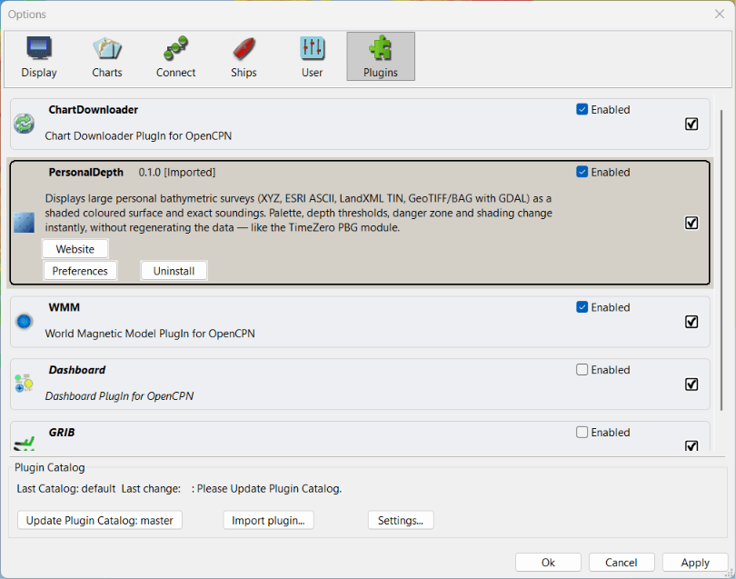

> 🧪 **Testers — check:**
> - the import is accepted (no "incompatible plugin" message);
> - the toolbar icon appears and opens the panel without crash;
> - your system, OpenCPN version and file name, to put in your test report.

## 2. First try in 5 minutes (sample data)

Ready-made database files for the Iroise Sea (Litto3D® Finistère 2014, 1 m
resolution, depths at chart datum) let you see the rendering without importing
anything.

1. Download the `.pdb` files of the
   [data-litto3d-finistere-samples](https://github.com/margouilla/PersonalDepth_pi/releases/tag/data-litto3d-finistere-samples)
   release and put them **in one folder** (e.g. `Documents/PersonalDepth/base`).
2. In the PersonalDepth panel, *Bathymetry database* section: click **…** and
   choose this folder. The `.pdb` files appear in the list.
3. Select the files and click **Centre**: the chart moves to the Iroise Sea.
4. Zoom in: the colour surface appears, then the exact soundings at large
   scales.

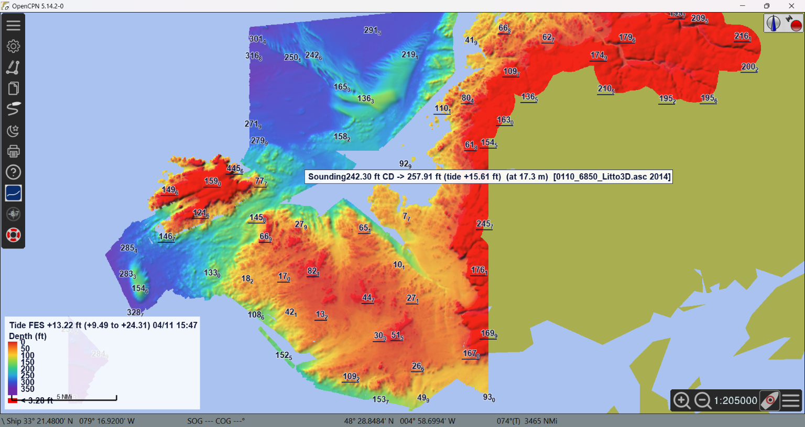

> 🧪 **Testers — check:**
> - the coloured, shaded surface is displayed (not a uniform colour);
> - panning and zooming stay fluid; soundings appear at large scale;
> - moving the cursor over the data shows the depth next to the cursor
>   (and in the panel, *Cursor: …*).

### The palette banner

At the bottom of the chart, a banner shows the colour palette:

```
 -10       [A][View]       80 m   ⚙
 ▇▇▇▇▇▇▇▇▇▇▇▇▇▇|▇▇▇▇▇▇▇▇▇▇▇▇▇▇▇▇▇
```

| Click on | Effect |
|---|---|
| **A** / **M** | Automatic palette (thresholds computed from the depths) or manual palette |
| **View** / **All** (automatic only) | Thresholds computed from the displayed area or from all the data |
| Minimum or maximum depth | Type a palette bound. Automatic: imposed bound (empty = computed); manual: thresholds stretched over the new range |
| Colour bar | Choose a colour preset |
| Small colour bar (next to ⚙) | Switch the banner between **horizontal** and **vertical**; the vertical banner also shows the intermediate thresholds |
| ⚙ | Open the main panel |

The mark on the colour bar is the safety depth. **Drag the banner** with the
mouse to put it anywhere on the chart (the position is kept). In *Display*
you can hide it, choose a fixed position (bottom centre, top centre, bottom
left, free) and **lock its position**.

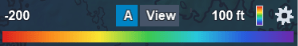 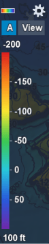

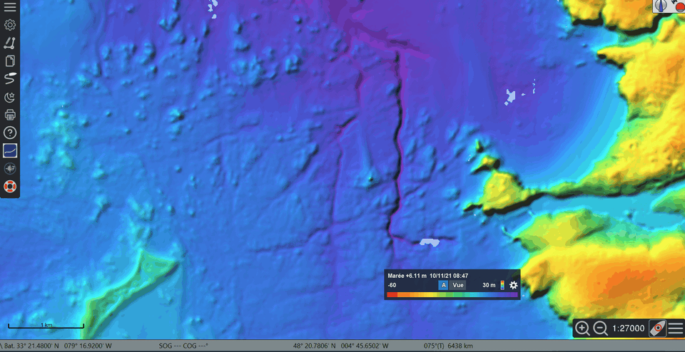

> 🧪 **Testers — check:** every click on the banner works, the chart does
> not move when clicking on or dragging the banner, and the locked banner
> cannot be dragged.

## 3. The main panel

The panel is divided into five tabs:

| Tab | Content |
|---|---|
| **Database** | Database folder, list of `.pdb` files (tick to show or hide), *All* / *None*, *Centre*, **Data management…**, *Stop* |
| **Tide** | Tide source and moment, information line, **Tide curve…** (§ 8) |
| **Palette** | Colours, thresholds, automatic mode, danger zone, palette folder (§ 6) |
| **Contours and soundings** | Depth contours (interval, major lines, values) and soundings (spacing, decimals, text size) (§ 7) |
| **Display** | Opacity, relief shading, smoothing, interpolated areas, cursor readout, palette banner (§ 7) |

The *Cursor: …* line (depth under the cursor) stays visible below the tabs,
whatever the open tab. The last open tab is remembered.

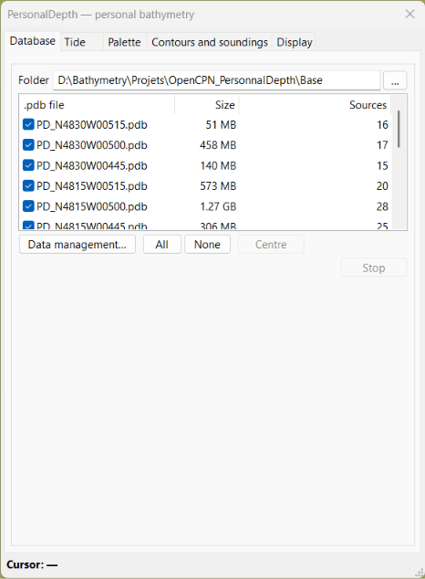

Every change is applied immediately on the chart. The panel can stay open
while you use OpenCPN; closing it keeps the display.

The database is split into **`.pdb` files**, one per geographic cell
(0.25° × 0.25° by default). Unticking a file hides its area, which is handy to
compare with the official chart.

> 🧪 **Testers — check:** ticking / unticking a `.pdb` file hides / shows its
> area; *Stop* interrupts a running operation.

## 4. Importing a survey

*Bathymetry database* › **Data management…** › **Import…**

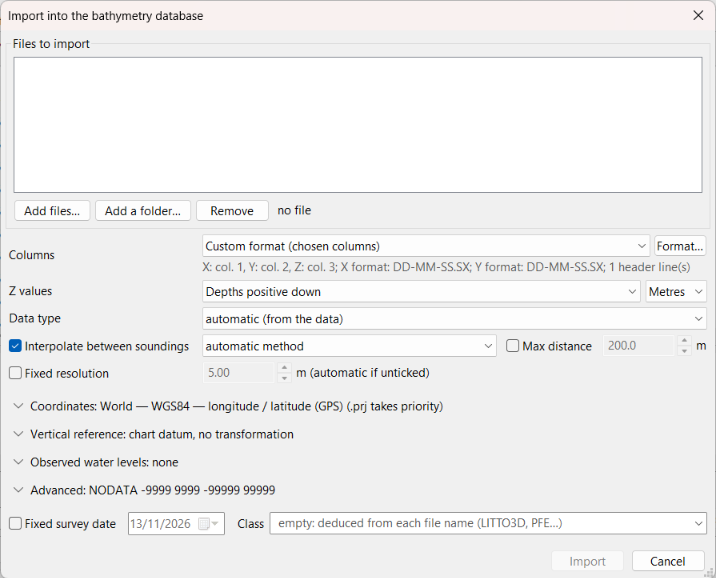

The window always shows the files and the everyday settings; less frequent
settings are in **collapsible sections** whose title sums up the current
setting (e.g. *▸ Coordinates: World — WGS84 — longitude / latitude*). Click a
title to open the section. Rows that do not apply to the chosen setting (UTM
zone, vertical reference files…) are hidden.

**Files** — *Add files…* or *Add a folder…* (all bathymetry files of the
folder and its sub-folders). Supported: XYZ text (`.xyz .txt .csv .dat`, any
separator, headers skipped), ESRI ASCII grids (`.asc`), LandXML TIN
(`.xml`); GeoTIFF / BAG on builds with GDAL.

**Everyday settings** (always shown)

| Setting | Meaning |
|---|---|
| Columns | `X Y Z` (lon lat z / East North z), `Y X Z`, or **Custom format** (see below) |
| Z values | Direction: *Automatic*, *Depths positive down*, or *Heights* (bottom negative, e.g. Litto3D); unit: metres or feet (the database always stores metres) |
| Data type | *Automatic*, **grid** (regular step, already processed: never interpolated), *single-beam echosounder* (tracks, profiles), *dense cloud* (multibeam, lidar), *chart soundings*, *lead-line soundings*, *point cloud (other)*. Forces the result of the survey analysis and sets the maximum interpolation distance (see below) |
| Interpolate between soundings | Point clouds only: surface computed between the soundings at import, with the method chosen next to it: *automatic method* (natural neighbour for a line survey, otherwise TIN), *TIN (linear)*, *natural neighbour (Sibson)* or *IDW (inverse distance)* (see below). *Max distance*: sets D by hand, in metres |
| Fixed resolution | Horizontal step of the database for this survey (soundings and interpolated surface). Unticked: given by the survey analysis, usually the best choice. A resolution coarser than the sounding spacing merges several soundings per cell and gives a blocky look |

**Collapsible sections**

| Section | Content |
|---|---|
| Coordinates | Coordinate system of X, Y (catalogue, UTM zone, EPSG code or PROJ string), neighbouring `.prj` file taking priority (see below) |
| Vertical reference | Datum of the file's Z values: chart datum, mean sea level, LAT, ellipsoid, IGN69… (see below) |
| Observed water levels | Corrects each time-stamped sounding with the water level of a gauge at its time (see below); opens by itself when the correction is on |
| Advanced | *Offset* (constant added to the depths, in the Z unit); *NODATA* (values to ignore, e.g. `-9999 9999`, in addition to the grid header NODATA); *Z bounds* (keep only depths between Z1 and Z2, e.g. −200 to 200 m removes fill values); *Binary cache* (`.pdpc` next to the source for a faster re-import) |

At the bottom: *Fixed survey date* and *Class*.

**Grid or point cloud** — each file is analysed at import (the result is
shown in *Data management*, line *Analysis*, with the distance D used and
the number of interpolated cells):
- a **grid** (regular nodes, already processed: Litto3D, NONNA, EMODnet,
  `.asc`…) is recognised even in projected coordinates with rounding noise or
  written in degrees; it is stored at its own step, **without
  interpolation**;
- a **point cloud** (sounding lines, scattered soundings, chart soundings,
  multibeam or lidar points) has no defined step: the analysis measures the
  spacing between neighbours and, for a **line survey**, the gap between the
  lines.

**Interpolation** — for a point cloud, a surface is triangulated (TIN)
between the soundings, filling the cells without a sounding, but **never
across a gap wider than the maximum distance D**: for a line survey, D covers
the large gaps between lines (1.25 × the gap exceeded by only 5 % of the
intervals between lines); otherwise twice the sounding spacing (three times
for multibeam and lidar; for chart soundings and lead line, at least the
usual large gaps between soundings, capped at 1,000 m / 500 m). Interpolated
cells are marked as such in the database: a **measured** cell always wins,
whatever the source and the priority rule; the *Display* panel can hide or
lighten them (§ 7); soundings are never taken from them and the cursor shows
*(interpolated)*. Set *Data type* to the real kind of survey if the
automatic result is not right (e.g. old lead-line survey), or set *Max
distance*: a larger value fills more gaps, never fewer.

The surface is computed once, at the sounding step (at most D / 128), and is
drawn **the same at every scale**: no hole or streak that appears or
disappears when zooming.

**Interpolation method** — the filled area is the same for all methods (the
triangles with no side longer than D); only the values change:
- **TIN (linear)**: a plane in each triangle. The fastest; between parallel
  lines, the long thin triangles can leave streaks along the lines.
- **Natural neighbour (Sibson)**: a weighted mix of the surrounding soundings
  (discrete Sibson method), smoother, without triangle edges.
- **IDW (inverse distance)**: mean of the 3 nearest soundings in each quarter
  around the point (12 at most) within D,
  weighted by the inverse square distance; smooth, but forms "dimples" around
  isolated or outlying soundings.

The *automatic method* takes the natural neighbour for a line survey (no
triangle streaks between the lines) and TIN otherwise. The method used is
shown with the analysis in *Data management*. To change
it, re-import the survey.

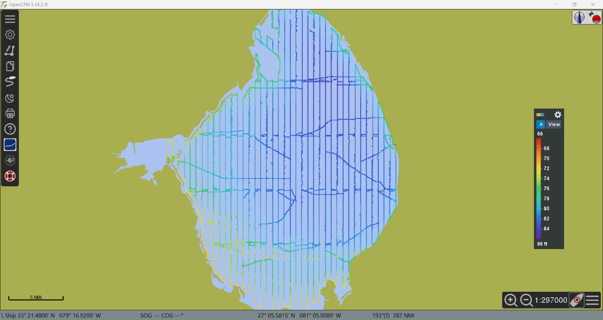 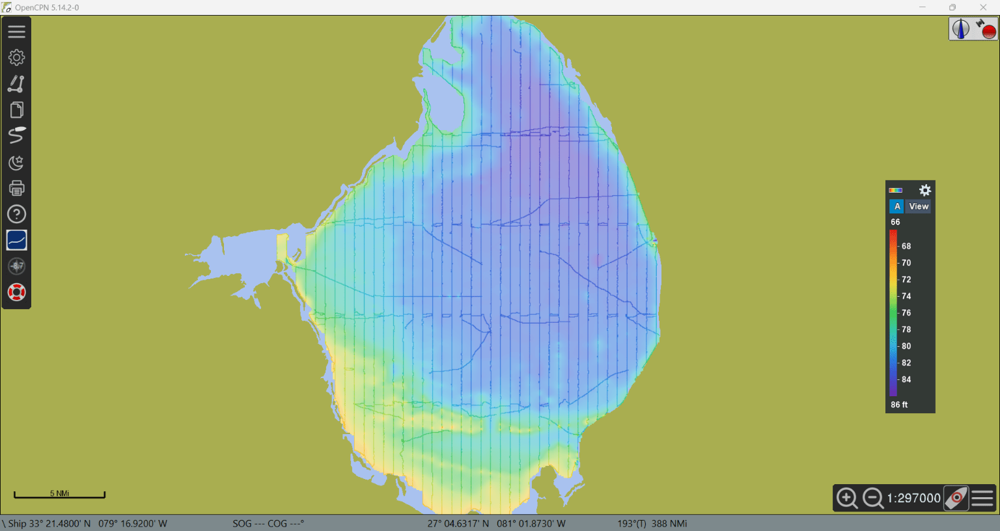

*Lake Okeechobee (NOAA): lines only, then interpolated between the lines.*

> 🧪 **Testers — check:** a single-beam survey in lines gives a continuous
> surface between the lines but not across wide gaps; a grid file is not
> interpolated (the analysis says "grid"); import time and database size.

**Custom format** (*Columns* › *Custom format*, button **Format…**) — for
text files that are not plain X Y Z: GNSS / RTK exports, sounder logs, CSV
with headers… The window opens by itself each time text point files are
added (files or folder), with a preview of the first added file, and shows the first lines of the file in colour:

- *Header lines to skip*, *Column separator* (automatic, spaces, comma,
  semicolon, tab), *Decimal mark* (period or comma);
- the column holding **X** (longitude / East), **Y** (latitude / North),
  **Z** (depth), and optionally the **date** (or date and time) and the
  **time**. Below the preview, the position of the first sounding is written
  out (e.g. *53.7532° N, 81.3522° E*): when latitude and longitude are both
  below 90° (common, e.g. a Garmin Quickdraw export in "latitude, longitude"),
  the order cannot be guessed; check this position, and a warning flags a
  polar latitude that betrays swapped columns; *Date order* for dates like 03/04/2021; under the date, the
  **time zone** of the file (fixed offset from UTC, e.g. UTC+08:00, no
  daylight saving change; dates are converted to UTC);
- optional **patterns** under the columns, as in hydrographic software:
  date / time with `y M d h m s z AP` (e.g. `yyyy/M/d`, `d/M/y h:m:s.s`,
  `MMM d, y`, `yyyyMMddhhmmss`), X and Y coordinates (each its own pattern)
  in degrees / minutes / seconds with `D M S X` (e.g. `D M S.S X`, `DDMM.MX`
  for NMEA). Empty = automatic recognition: decimal number, or degrees-
  minutes-seconds with symbols and hemisphere letter (`54° 00' 28.44" N`,
  the N/S column going to Y and the E/W column to X). *Format help…*
  lists the fields and examples;
- under **Z**: the direction of the values (depths positive down, heights
  positive up, or automatic) and their unit (metres or feet) — the same
  settings as in the import window;
- *Automatic detection* guesses everything from the file (column names of the
  header such as `latitude`, `lon`, `depth` are recognised); red cells are
  values that cannot be read for their role;
- *Save format… / Load format…* keep a format in a `.pdfmt` file for the
  next surveys of the same kind.

When a date column is set, the **survey date** of the source is the first
date of the file (unless a fixed survey date is given).

**Observed water levels** — for a survey whose soundings are measured from
the water surface (single-beam sounder on a lake, a river…), each sounding
can be corrected with the water level read on a staff gauge or a tide gauge
at the time of the sounding. The water level files are text files with one
level per line, in the Z unit:

```
[TIME],[DEPTH]
2026-11-01 05:00:00,0.35
2026-11-01 06:00:00,0.41
```

(a date alone, `2026-11-01,0.35`, is fine for daily values). Choose a
**file** or a **folder**: all the `.txt`, `.csv`, `.dat` files of the
folder form a single series (one gauge, successive periods). The **Format…**
window (the same as for soundings) opens on the first file: header lines,
separator, date / time / level columns and patterns, **unit** of the levels
(metres or feet), **time zone**, and the convention. The level at
the time of each sounding is interpolated between the two levels around it;
outside the series, the end value is kept for one time step (1 hour to
1 day), further away the sounding is discarded and counted in the import
summary. By default **depth = sounding − level** (level above the datum);
*depth = sounding + level* is the other convention. **Curve…** shows the
water level series in UTC (mouse wheel to zoom on time, double-click for the
whole period).

The soundings should carry their date and time: use the **custom format**
with a date column (and time). Soundings and levels are compared in UTC: set
the **time zone** of each format to the one of its file. **Soundings without
a time** (simple `lon lat depth` file): the level of the **survey day** is
applied to the whole file, taken at noon in the time zone of the water levels;
the day comes from *Survey date* or, failing that, from a date `YYYYMMDD` in
the file name.

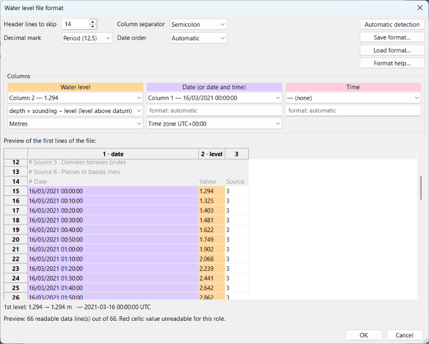

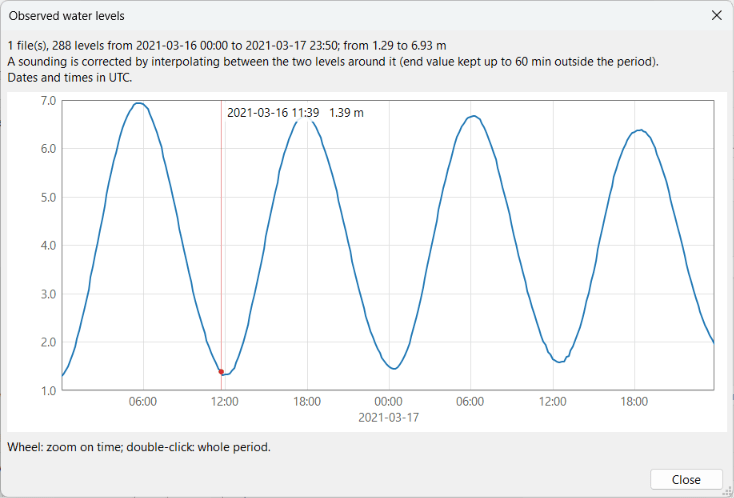

> 🧪 **Testers — check:** a survey with water levels gives the expected
> corrected depths; the curve matches your gauge.

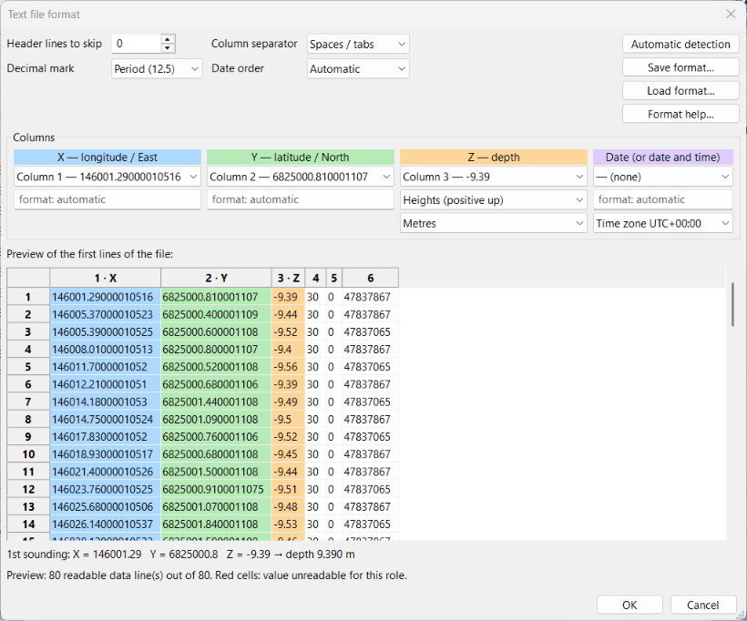

**Coordinate system (X, Y)** — choose from the list: *Automatic* (the `.prj`
file next to the data, otherwise longitude / latitude in degrees), WGS84, UTM,
Lambert-93, CC42–CC50, many national systems, **NAD83 State Plane** (all US
zones, in metres, US survey feet or feet — e.g. for USACE surveys), or
*Other* with an EPSG code / PROJ string. *Use the neighbouring .prj file*
takes priority when the file has one (ESRI State Plane `.prj` files are
recognised). Projected coordinates (UTM, Mercator…) cannot be identified
from the numbers alone: without a `.prj` file, choose the system.

**Vertical reference of Z** — state which datum the depths of the file refer
to. The database then stores them below **mean sea level** (see
[Vertical datum of the database](#vertical-datum-of-the-database)):

| Choice | For | Files needed |
|---|---|---|
| *Local chart datum* | Charts, Shom surveys, echo sounder corrected for the tide (ZH in France, Chart Datum elsewhere) | None (BathyElli in France, FES2022 elsewhere, to link it to mean sea level) |
| *Mean sea level (MSL)* | GEBCO, ocean models | None |
| *Lowest astronomical tide (LAT)* | EMODnet | FES2022 atlas (*Tide* tab) |
| *Ellipsoidal heights* | GNSS / RTK / PPK survey without geoid | BathyElli NM in France, otherwise the MSS (`.pdgrid`) |
| *IGN69 / IGN78C → CD* | French land heights (e.g. Litto3D) | BathyElli + RAF20 / RAC23 folder |
| *Other land datum* or *offset grid* | Your own grids | Your files |
| *Not tied* | Lake, reservoir, non-tidal water | None: depths kept as they are |

See [external-data.md](external-data.md) to get these files.

**Fixed survey date** — otherwise the date is read from the file name
(`YYYYMMDD`), failing that the file date. It is used by the "most recent"
priority rule. **Class** — free label to group sources (e.g. `LITTO3D`,
`My surveys`); empty = deduced from the file name.

Click **Import**. Progress is shown at the bottom of the window; *Stop*
cancels the file in progress (files already finished stay in the database).
Files already in the database are detected: you can import only the new ones
or re-import everything (replace).

> 🧪 **Testers — check:**
> - import of one of your own files (format, size, coordinate system);
> - import time and memory use for big files (please note the file size and
>   number of soundings);
> - a file in **feet** shows the right depths after import.

## 5. Data management

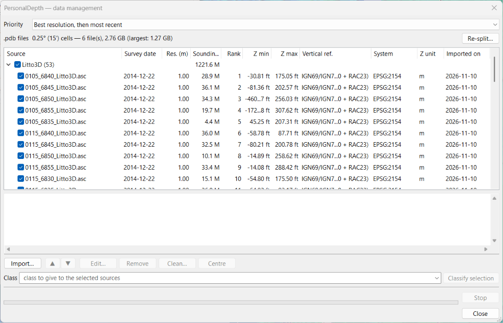

The list shows the sources grouped by class, with: survey date, resolution,
number of soundings, rank, Z min / max, vertical reference, coordinate system,
Z unit and import date. The tick box of a source (or a class) includes it or
not in the merge. The bottom pane gives the details of the selection,
including the **covered area** (area of the database cells holding soundings,
in km² and NM²; for several sources, the sum).

| Action | Effect |
|---|---|
| **Priority** | Rule used where surveys overlap: *Best resolution, then most recent* (default), *Shoalest sounding*, *Most recent survey*, *List order (manual rank)*. No averaging: each pixel takes the value of one source |
| ▲ ▼ | Rank order, for the *manual rank* rule |
| **Edit…** (or double-click) | Survey date and class (instant); Z unit, coordinate system, vertical reference (the original files are re-read) |
| **Remove** | Removes the sources from the database (original files untouched) |
| **Clean…** | Deletes the soundings outside Z1 – Z2 (e.g. fill values) |
| **Centre** | Centres the chart on the selection |
| **Classify selection** | Gives a class to the selected sources |
| **Re-split…** | Changes the size of the geographic cells of the `.pdb` files (smaller cells = smaller files) |

> 🧪 **Testers — check:** changing the priority rule changes the display
> where two surveys overlap; *Edit…* of the date or class is immediate.

### Vertical datum of the database

Every source keeps its original datum, but the database stores all depths
**below mean sea level** (MSL). It links them to the other datums with
surfaces computed once and kept in the database folder
(`PersonalDepth_datum.sqlite`):

| Datum | Surface used |
|---|---|
| Local chart datum | France: Shom ZH (BathyElli v2.1 NM − ZH); elsewhere: FES2022 lowest astronomical tide (LAT); without these files: "undefined", zero offset |
| LAT | FES2022 lowest astronomical tide over 19 years |
| WGS84 ellipsoid | France: BathyElli v2.1 NM; elsewhere: mean sea surface (MSS CNES_CLS 2025) |

In the **Database** tab, *Vertical datum* box:

- **Depths**: datum of the depths shown (colours, soundings, contours,
  cursor). Default: *local chart datum*, so values match the charts (ENC,
  RNC) and a source imported at chart datum shows exactly its original
  values. With the tide, the display is always the actual water depth (chart
  datum + tide).
- **MSS**: mean sea surface file (`.pdgrid`), for GNSS heights and the
  display at the ellipsoid outside France.
- The information line gives the datum shown, the surface used (e.g. *CD
  BathyElli v2.1*, *LAT FES2022b*, *undefined*) and the reference files
  found.
- **Update surfaces**: after adding or changing BathyElli, the FES2022 atlas
  or the MSS, recomputes the surfaces and corrects the sources concerned. The
  chart-datum display of a source imported at chart datum does not change.
- **Migrate database…** (databases created before version 0.1.0-beta.10, at
  chart datum): when such a database is opened, PersonalDepth offers to
  convert it to mean sea level. The `.pdb` files are first copied to
  `backup_before_MSL` (in the database folder). Without migration the
  database is still displayed as it is, but import is blocked. A migrated
  database must no longer be opened with an earlier version of the plugin.

**Clean** (Z1 – Z2 bounds) compares depths at local chart datum, like the
charts.

> 🧪 **Testers — check:** after migration, depths at chart datum are the same
> as before; *Mean sea level* increases them by the height of MSL above chart
> datum (about 4 m at Brest); a GEBCO file imported at *mean sea level* is
> shown at chart datum.

### Coastline

Between two sounding lines, the interpolated surface may bridge an island or
a headland. The *Coastline* box of the **Database** tab prevents it:

- **Folder**: folder of the basemaps downloaded by OpenCPN's chart
  downloader, **OSMSHP** (OpenStreetMap land polygons, `basemap_*.shp`,
  recommended: accurate to a few metres) or **GSHHG** (`poly-*-1.dat`,
  coarser: coastline sometimes offset by a hundred metres, small islands
  missing). A folder holding both is fine: OSMSHP is preferred, in its best
  quality present (`full`, then `high`…).
- **No interpolated surface on land**: at import, interpolated pixels on land
  are removed. Measured soundings are always kept (intertidal surveys,
  Litto3D).
- **Apply to sources**: removes the interpolation on land from the sources
  already imported. To get it back, re-import the source.

See [external-data.md](external-data.md) to download these basemaps.

> 🧪 **Testers — check:** a line survey around an island no longer covers it;
> soundings measured on the foreshore are still shown.

## 6. Palette and depth thresholds

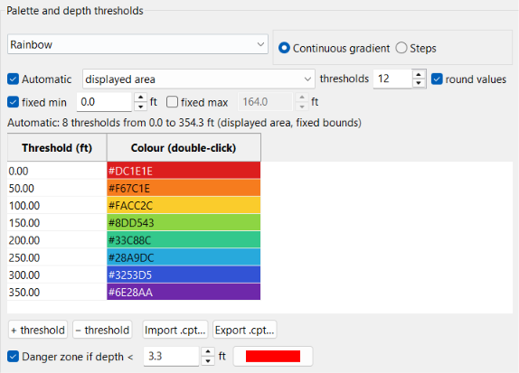

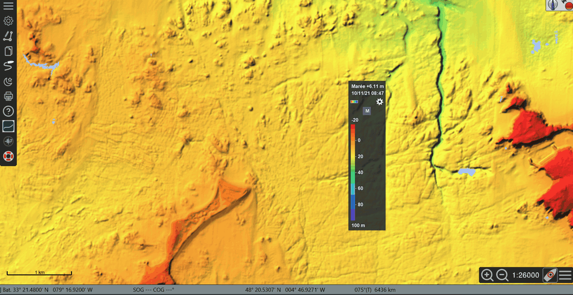

- **Presets**: *TimeZero PBG (blues)*, *Nautical chart (steps)*, *OpenCPN
  ENC (S-52)* (the depth colours of OpenCPN's vector charts, with the
  shallow / safety / deep contours set in *Options › Charts › Vector
  Charts*), *Rainbow*, *Draught safety*, *Greyscale*. Any change makes it
  *(custom)*.
- **Continuous gradient** or **Steps**.
- **Table**: one line per threshold (depth, colour). Edit a depth directly,
  double-click a colour to change it; *+ threshold* / *− threshold*.
- **Import .cpt… / Export .cpt…**: GMT palettes.
- **Palette folder**: all palettes are `.cpt` files of a single folder
  (*Palette folder…* to choose it), the original palettes included: they are
  written there the first time, and can then be edited, renamed or deleted
  like any other. Only *OpenCPN ENC (S-52)* stays apart, since it follows
  OpenCPN's depth contour settings. *Save palette…* stores the displayed
  palette (thresholds, colours, steps or gradient, danger zone) in the folder;
  GMT `.cpt` palettes copied there are offered too. *Restore original
  palettes* writes the shipped palettes back (files of the same name are
  replaced). The list is the same in the panel and in the menu of the
  banner's colour bar.
- **Automatic**: N thresholds spread between the minimum and maximum depth of
  *all data* or of the *displayed area* (recomputed when the chart moves),
  with *round values*, and optional *fixed min* / *fixed max* (e.g. fixed min
  0 m: the palette covers the sea bottom only). Editing a threshold by hand
  turns automatic mode off.
- **Danger zone if depth < X**: overlay of the areas shallower than your
  draught plus a margin; the red safety contour follows it.

Depths are positive downwards; negative values are above the datum shown
(drying areas, land).

> 🧪 **Testers — check:** every palette change is instant on the chart
> (no reload); the danger zone matches the depth you set.

## 7. Depth contours, soundings and display

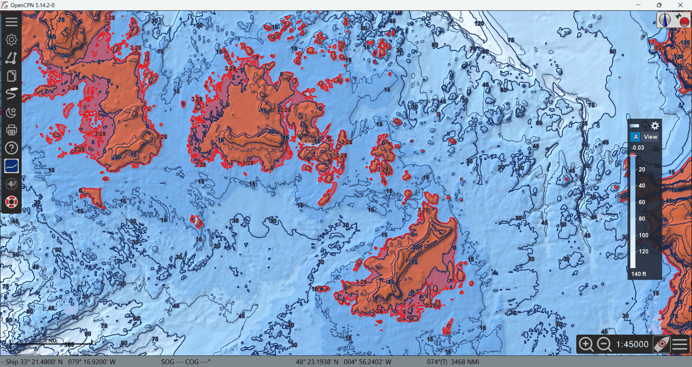

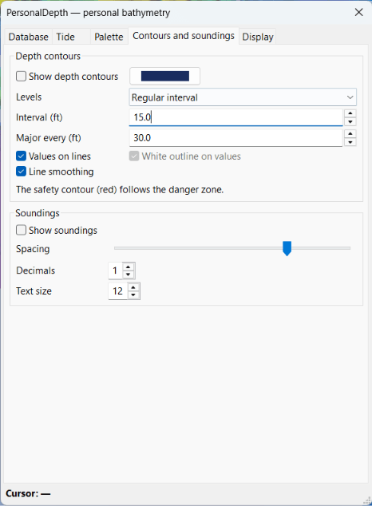

**Contours and soundings tab**

**Depth contours** — *Show depth contours*; levels at a *Regular interval*
or on the *Palette thresholds*; *Major every* N units (thick line); *Values on
lines* (solid figures, in the line colour); *Line smoothing* (display
only). No line is drawn in the gaps of the
survey.

**Soundings** — *Show soundings*: exact soundings (shoalest per screen
cell), never taken from interpolated areas; *Spacing* (minimum gap between
two soundings on screen); *Decimals*; *Text size* (soundings and contour
values).

**Display tab**

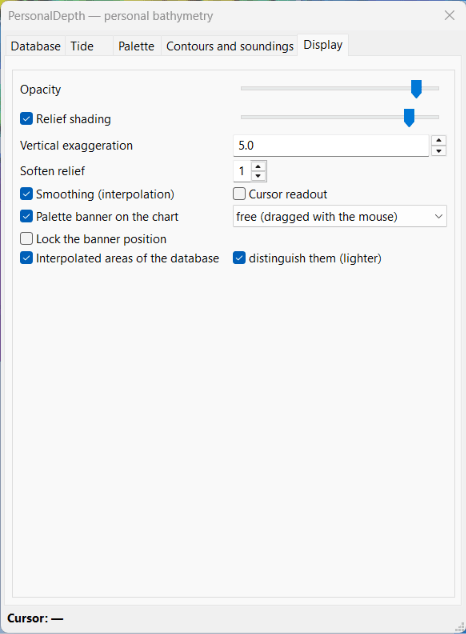

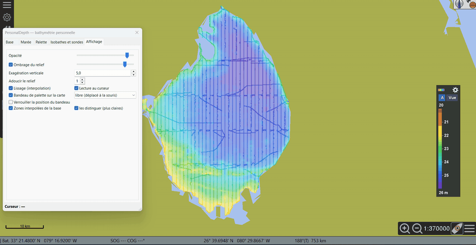

| Setting | Effect |
|---|---|
| Opacity | Transparency of the colour surface over the chart |
| Relief shading | Hillshading and its strength |
| Vertical exaggeration | Accentuates the relief of the shading |
| Soften relief | Smooths the shading only (colours, contours and soundings keep the true depths) |
| Smoothing (interpolation) | Smooth colours between grid cells |
| Interpolated areas of the database | Show the surface interpolated at import between soundings; *distinguish them (lighter)* lightens its colours |
| Cursor readout | Depth and source next to the cursor |
| Palette banner on the chart | Show the banner and choose where it sits |

> 🧪 **Testers — check:** contours and soundings are readable and do not
> overlap too much; the cursor readout gives the same value as the sounding
> under the cursor.

## 8. Tide

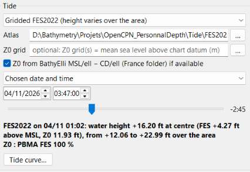

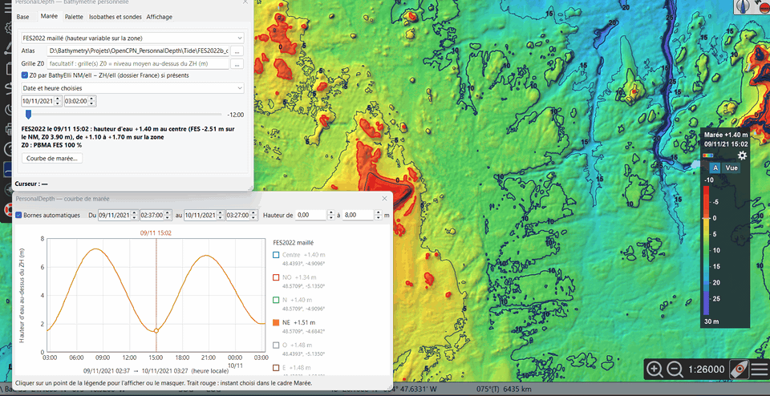

Without tide, depths are shown in the chosen datum (*Database* tab, local
chart datum by default). The *Tide* section adds the water height of a given
moment above chart datum, pixel by pixel:

- **Source**: *OpenCPN tide stations* (single height from the nearest
  station; OpenCPN tide data must be enabled) or *Gridded FES2022* (height
  varies over the area; needs the converted atlas, see
  [external-data.md](external-data.md)).
- **Moment**: *None — depths at chart datum*, *Current water height
  (computer clock)*, or *Chosen date and time* with the ±12 h slider in
  15-minute steps.
- The information line gives the height used, the station or the FES2022
  range over the area.

**Tide curve…** opens a separate window: water height against time for each
tide point used (the OpenCPN station, or up to 9 FES2022 points — NW, N, NE,
W, Centre, E, SW, S, SE — spread over your data).

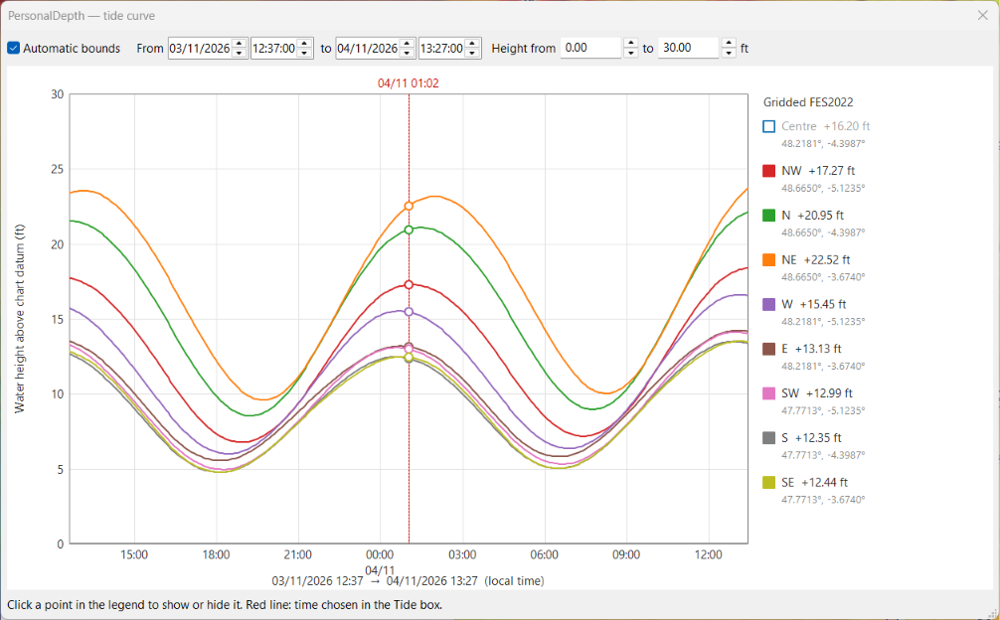

- Click a point in the legend to show or hide its curve.
- *Automatic bounds*: one tide cycle (24 h 50) around the chosen moment;
  editing a bound (dates, heights) switches to manual bounds.
- The red line is the chosen moment (live in *Current water height* mode).

> 🧪 **Testers — check:** the station tide height matches OpenCPN's own tide
> window; the red line of the tide curve follows the moment chosen in the
> panel.

## 9. Units and language

- **Units** follow OpenCPN: *Options › Display › Units* (metres or feet;
  fathoms are shown in feet). Soundings, contours, legend, thresholds, danger
  zone and tide heights switch together.
- **Language** follows OpenCPN: *Options › User › General options ›
  Language*. French gives French, Russian gives Russian, any other language
  gives English, unless a translation file exists for it (below). Class
  names and labels stored in the database keep the language they were
  created in.
- **Translation files** — translations other than English are text files
  `PersonalDepth_<code>.po` (gettext format, editable in a text editor or in
  Poedit): `msgid` = English text, `msgstr` = translation, and the original
  French text as a comment. The plugin ships `PersonalDepth_ru.po` in
  `data/lang` of its folder. To correct a translation or add one (e.g.
  `PersonalDepth_de.po` for German), put the file in the `lang` subfolder of
  the plugin's user folder (the one that holds the `palettes` folder; on
  Windows `%LOCALAPPDATA%\opencpn\plugins\PersonalDepth_pi\lang`): it is read
  after the shipped file, its entries win, and plugin updates leave it alone.
  Only the changed entries are needed. Restart OpenCPN to apply it. A
  translation whose `%d`, `%s`, `%.2f`… differ from the English text is
  ignored (noted in OpenCPN's log).

> 🧪 **Testers — check:** switching OpenCPN between metres and feet updates
> the whole display; English or Russian texts that are wrong or still in
> French (please quote them).

## 10. Reporting a problem

Use the [problem report form](https://github.com/margouilla/PersonalDepth_pi/issues/new?template=bug_report.yml)
(free GitHub account needed) or the
[Cruisers Forum thread](https://www.cruisersforum.com/forums/f134/plugin-dev-dynamic-bathymetry-and-topography-grid-overlay-302721.html).
Please include:

1. your **system** and **OpenCPN version** (*About* window, ? button of the toolbar), and the **name of
   the file** you installed;
2. what you did, what you expected, what happened;
3. a **screenshot** if it is a display problem;
4. the end of the **OpenCPN log** (lines with `PersonalDepth` and the last
   lines before a crash):

   | System | Log file |
   |---|---|
   | Windows | `C:\ProgramData\opencpn\opencpn.log` |
   | Linux, Raspberry Pi | `~/.opencpn/opencpn.log` |
   | macOS | `~/Library/Preferences/opencpn/opencpn.log` |

## 11. FAQ and known limitations

**The whole surface is one colour.** The data probably contain fill values
(e.g. −9999 or 999). Use *Data management › Clean…* with bounds such as
−200 / 200 m, or re-import with *NODATA* and *Z bounds*.

**Nothing is displayed.** Check that OpenGL is enabled, that the `.pdb` files
are ticked, and that you are zoomed on the data area (*Centre*).

**The import is slow.** Large grids (hundreds of millions of soundings) take
minutes; the import can be stopped and resumed (*import only the new files*).
On a Raspberry Pi, prefer importing on a PC and copying the `.pdb` files.

**Known limitations**
- Linux, Raspberry Pi and macOS packages are new and still being tested.
- Flatpak OpenCPN (Flathub) is not supported yet.
- Not compatible with Android (OpenGL ES).
- Mercator chart projection assumed; antimeridian not handled.
- Older datums (NTF, ED50, OSGB36…): mean Helmert parameters (~1–2 m).
- Interpolation is done at import: re-import a survey to apply a new survey
  type, nature or max distance. Line surveys imported before beta.9 should be
  re-imported (interpolated surface computed differently).
- Text files over 200 MB are imported in blocks (limited memory); a very
  dense survey makes a large database: a *Fixed resolution* (e.g. 0.5 m)
  reduces it a lot.
